<div align="center">

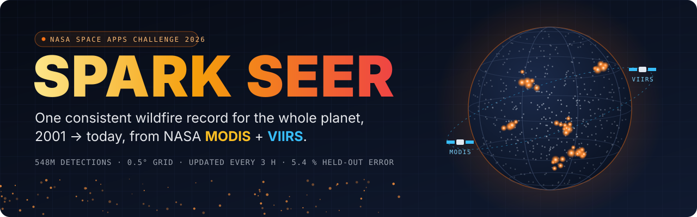

<br>

[](https://spark-seer.duckdns.org/)
[](https://spark-seer.duckdns.org/dashboard)
[](https://www.spaceappschallenge.org/)


**Challenge:** *Harmonization of MODIS and VIIRS Hot Spots* · **Team:** PizzaNeptune 🍕🪐

[Why](#-why-this-exists) · [Tour](#-a-tour-of-the-dashboard) · [How it works](#-how-it-works) · [Results](#-results) · [Architecture](#-architecture) · [Run it](#-run-it-locally) · [Team](#-team)

</div>

---

<p align="center">
  <a href="https://spark-seer.duckdns.org/">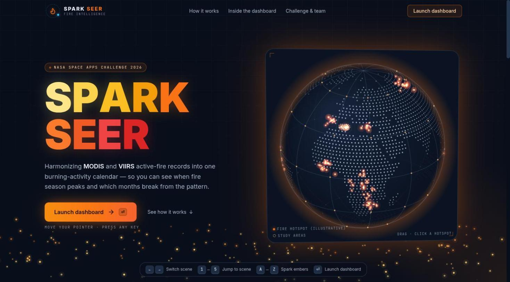</a>
</p>

## 🔥 Why this exists

NASA watches the planet's fires with two satellite families, and they **don't see fires the same way**:

| | MODIS (Terra, Aqua) | VIIRS (S-NPP, NOAA-20, NOAA-21) |
|---|---|---|
| Pixel size | 1 km | **375 m** |
| Record starts | 2000 / 2002 | 2012 |
| Hotspots found | baseline | **several times more** |

Glue the two records together naively and you get a **fake jump in fire activity in 2012**, the year
VIIRS arrives. A second break appeared in November 2026, when the S-NPP satellite's record ended and
the long-term series had to hand over to NOAA-20.

**Spark Seer harmonizes both families into one record that is consistent over time**, updates it
every three hours, and shows how reliable each number is.

<p align="center">
  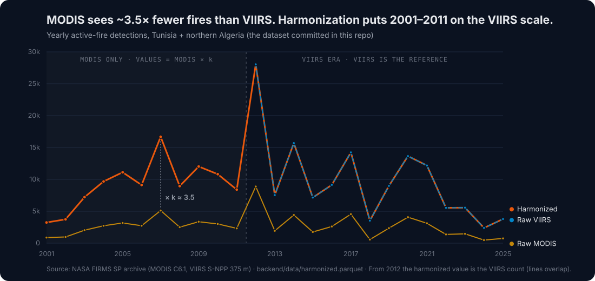
</p>

---

## 🧭 A tour of the dashboard

> Everything below is a live page at **<https://spark-seer.duckdns.org/dashboard>**. Pick an area, a sensor
> (Harmonized, MODIS or VIIRS) and a year range in the top bar; every page follows those filters.

### Overview: the latest month, against its own history

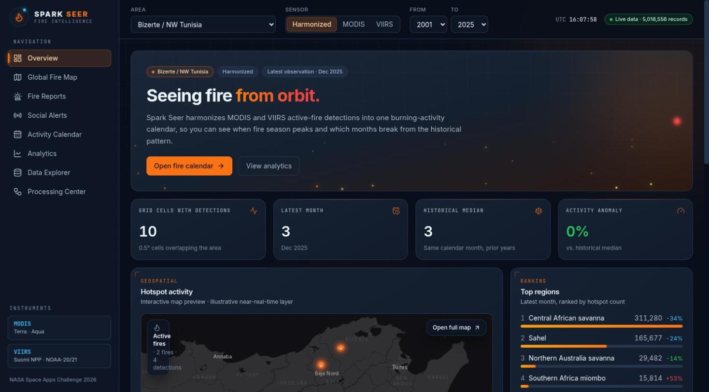

KPI tiles compare the latest month with the same calendar month in earlier years, next to a live map
preview and a ranking of the world's most active fire regions.

### Activity Calendar: the core view

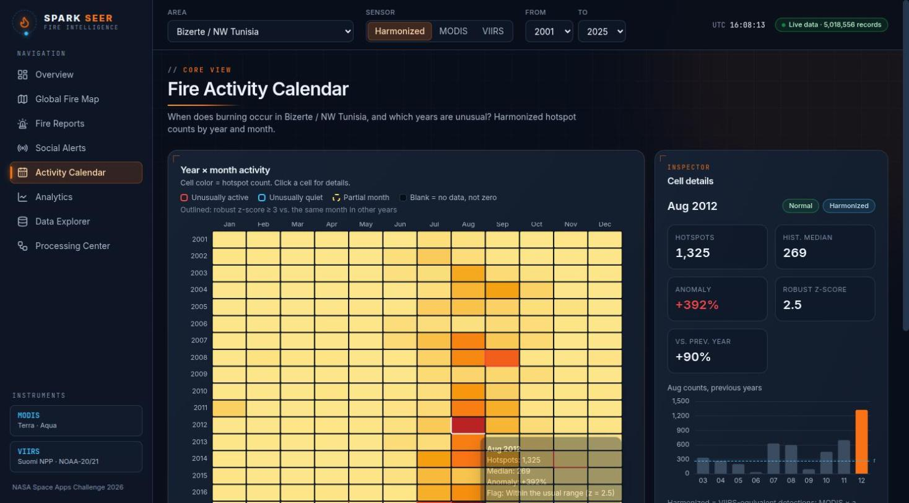

A **year × month heatmap** of harmonized hotspots for any area or drawn box. Unusual months are
outlined (robust z-score ≥ 3), partial months are marked, and **missing data is blank, never zero**.
Click a cell to see its count, the historical median, the anomaly and the same month in other years.

<table>
  <tr>
    <td width="50%" valign="top">
      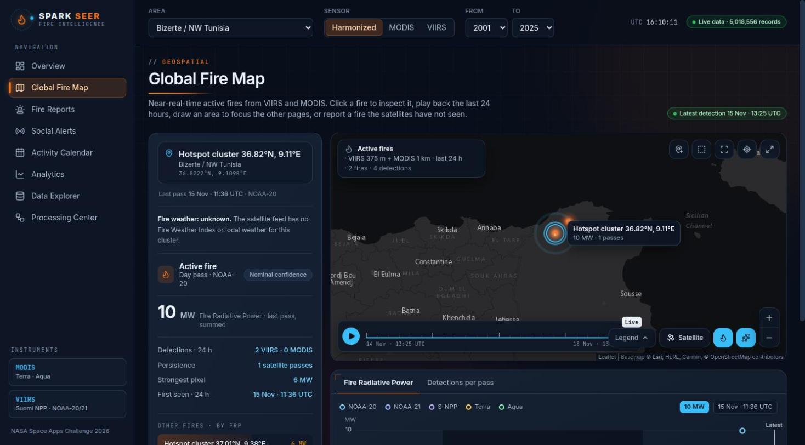
      <p><b>Global Fire Map.</b> Near-real-time NASA FIRMS detections. Click a fire for its radiative
      power, satellites and persistence, replay the last 24 h, or report a fire the satellites missed.</p>
    </td>
    <td width="50%" valign="top">
      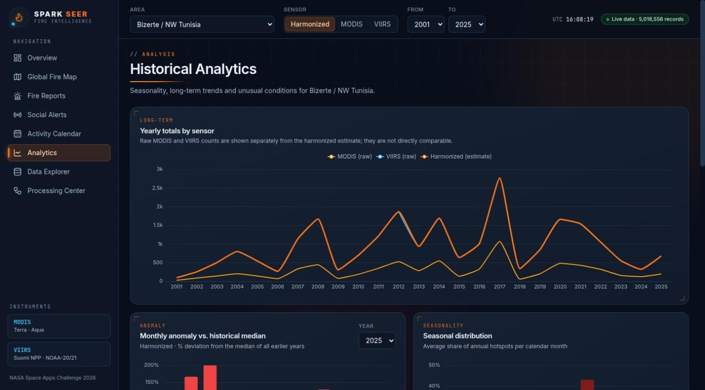
      <p><b>Analytics.</b> Yearly totals by sensor, seasonality, monthly anomalies and rankings, with
      raw and harmonized values kept visibly apart.</p>
    </td>
  </tr>
  <tr>
    <td width="50%" valign="top">
      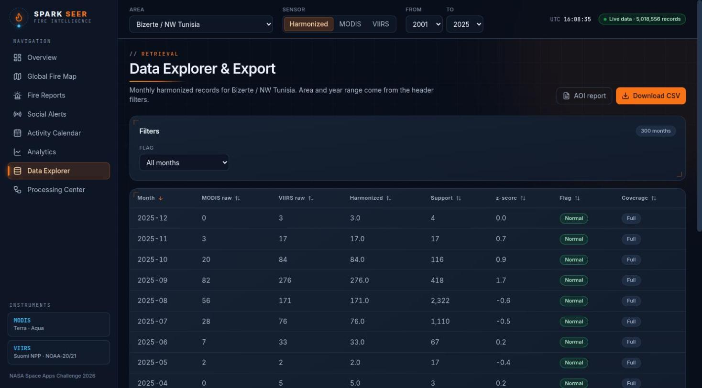
      <p><b>Data Explorer.</b> Every monthly number (raw MODIS, raw VIIRS, harmonized, support,
      z-score, flag and coverage) as a sortable table, with CSV export and an area report.</p>
    </td>
    <td width="50%" valign="top">
      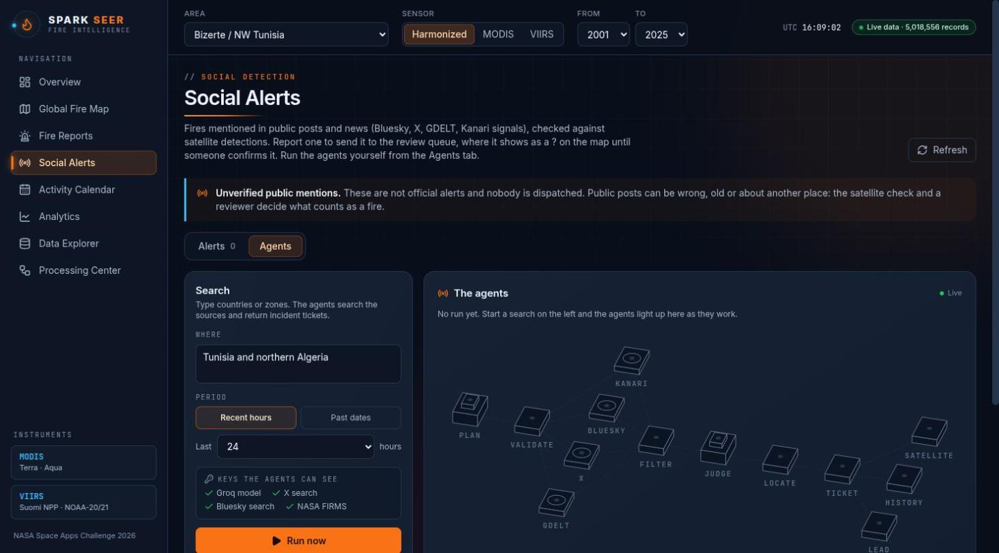
      <p><b>Social Alerts.</b> AI agents search Bluesky, X, GDELT and Kanari for fire reports, then
      locate them and check them against satellite detections. These are unverified leads, never official alerts.</p>
    </td>
  </tr>
  <tr>
    <td width="50%" valign="top">
      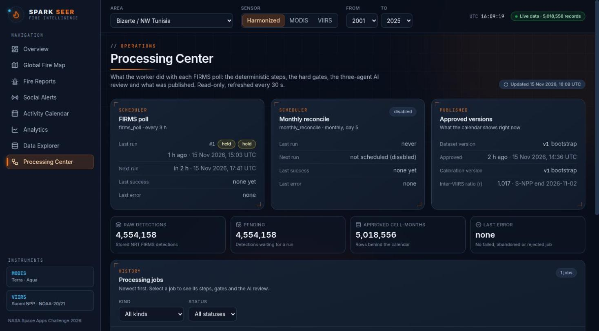
      <p><b>Processing Center.</b> Each 3-hourly run in the open: scheduler state, raw and pending
      detections, the published dataset version and every job.</p>
    </td>
    <td width="50%" valign="top">
      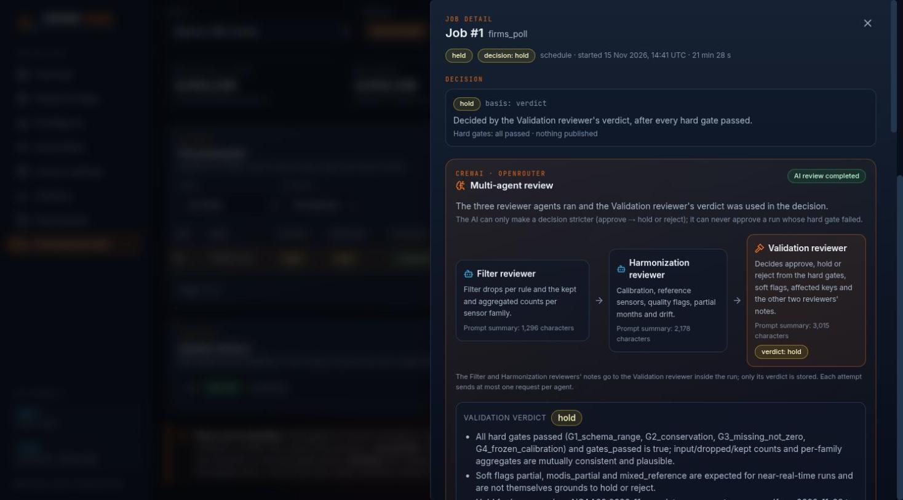
      <p><b>AI review, explained.</b> For each job, the three reviewer agents' roles, the verdict, its
      reasons and the model used. The AI can make a decision stricter, never looser.</p>
    </td>
  </tr>
</table>

**Fire Reports** (community reports, reviewed and checked against nearby detections and weather)
completes the set.

---

## ⚙️ How it works

### 1. Two satellite families → one reference

Each period of the record uses the best sensor available, converted to a single scale (VIIRS S-NPP):

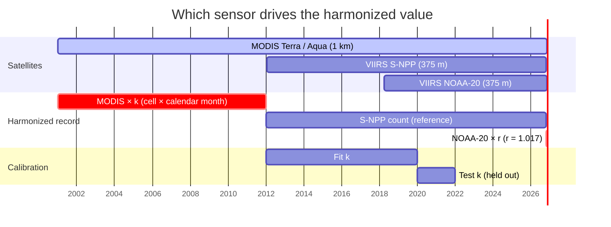

- **k** is a MODIS → VIIRS ratio for every 0.5° cell and calendar month, shrunk toward the regional value
  where data is thin. It is fitted on 2012-2019 and scored on 2020-2021, which the fit never saw.
- **r** carries the record past the end of S-NPP. It is approved only if it beats "no correction"
  on held-out years.

### 2. From 548 million detections to a 0.5° calendar

```mermaid
flowchart LR
    A["🛰️ NASA FIRMS<br/>548 M archive detections<br/>2001–2025 + live NRT"] --> B["Filters<br/>confidence rules"]
    B --> C["Static-source mask<br/>153,371 gas flares,<br/>industry, volcanoes"]
    C --> D["0.5° grid<br/>count per cell × month<br/>per sensor"]
    D --> E["Harmonize<br/>MODIS × k · S-NPP · NOAA-20 × r"]
    E --> F["Completeness<br/>partial / missing ≠ 0"]
    F --> G[("📅 Fire activity<br/>calendar")]
    classDef src fill:#0b3d91,stroke:#60a5fa,color:#fff
    classDef step fill:#111a2e,stroke:#f97316,color:#e5e7eb
    classDef out fill:#ea580c,stroke:#fdba74,color:#fff
    class A src
    class B,C,D,E,F step
    class G out
```

Live data goes through **exactly the same filters** as the archive, so history and new months stay comparable.

### 3. Every 3 hours: fetch → check → review → publish

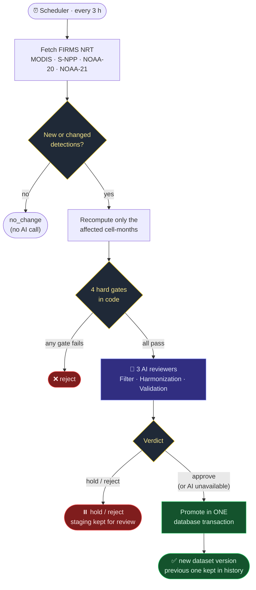

| Hard gate | What it guarantees |
|---|---|
| **G1** schema & range | counts are valid, keys unique, every affected cell-month appears exactly once |
| **G2** conservation | no detection is lost or double-counted, checked per cell-month **and** sensor |
| **G3** missing ≠ zero | an unavailable sensor gives *null + flag*, never a fake 0 |
| **G4** frozen calibration | live runs never silently refit `k` or `r` |

**Guardrails on the AI.** The reviewers read summaries only, never raw rows, and they never compute
or change a number. Any number they quote must appear in their input, or their answer is thrown out.
They can turn *approve* into *hold* or *reject*, but they can never approve a run that failed a gate.
If every model is down, the gates alone decide, so the AI's availability never stops the data.

---

## 📊 Results

<p align="center">
  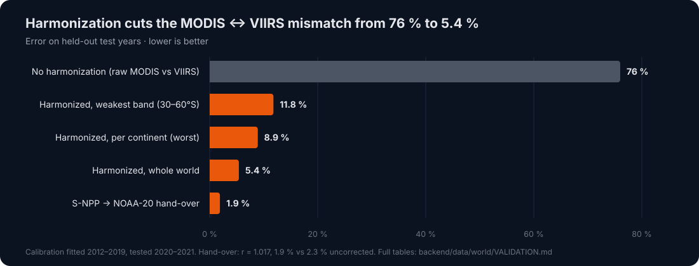
</p>

| Held-out test | Error |
|---|---:|
| Harmonized MODIS → VIIRS, whole world (cell-month calibration) | **5.4 %** |
| Per continent | 4.9 – 8.9 % |
| Without harmonization (raw MODIS vs VIIRS) | 76 % |
| S-NPP → NOAA-20 hand-over (r = 1.017, accepted because it beats no correction) | 1.9 % (2.3 % uncorrected) |

The **30-60°S band** (southern South America, South Africa, southern Australia, New Zealand) is
weaker, at 11.8 %, and is **flagged as such in the product rather than hidden**. Full tables are in
`backend/data/world/VALIDATION.md`, produced by `backend/scripts/build_world.py`.

---

## 🏗️ Architecture

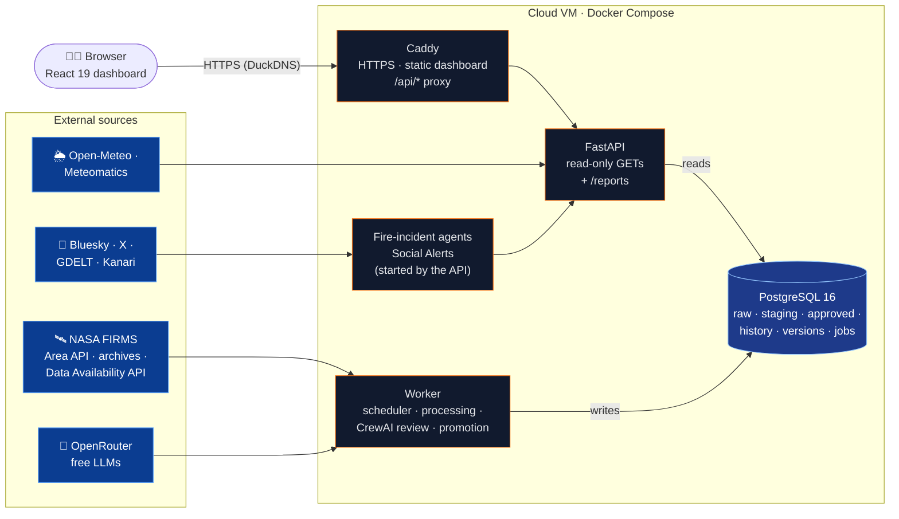

Design rules the code enforces, each with a test:

- **The API is read-only.** It never imports the worker or an LLM client.
- **Published data can't be damaged by a failed run.** Results go to staging and are promoted in one transaction.
- **No new data, no AI call.** Unchanged polls stop before CrewAI is even imported.
- **Restart-safe.** All schedule and job state lives in PostgreSQL, with one active job per kind.

The full specification is in **[docs/processing/ARCHITECTURE.md](docs/processing/ARCHITECTURE.md)**, and the
server setup is in **[DEPLOY.md](DEPLOY.md)**.

### Tech stack

| Layer | Tools |
|---|---|
| **Backend** | Python 3.11, FastAPI, pandas, PyArrow, Shapely, SQLAlchemy 2, psycopg 3, Alembic, PostgreSQL 16 |
| **AI** | CrewAI reviewer agents on OpenRouter free models (NVIDIA Nemotron, with automatic fallback); fire-incident agents for Social Alerts |
| **Frontend** | React 19, Vite, React Query, ECharts, Leaflet |
| **Operations** | Docker Compose, Caddy (automatic HTTPS), a cloud VM, DuckDNS |
| **Quality** | ~500 automated tests, including PostgreSQL integration tests and oracle tests showing the optimized processing gives identical numbers |

### Data sources

All fire data comes from **[NASA FIRMS](https://firms.modaps.eosdis.nasa.gov/)**:

- **MODIS Collection 6.1** active fires (Terra and Aqua): archive 2001-2025 and near-real-time
- **VIIRS 375 m** active fires: Suomi NPP (2012 to 2 Nov 2026), NOAA-20 (2018 onward), NOAA-21 (near-real-time)
- Access through the yearly archive files, the FIRMS Area API (live polling) and the Data Availability API

Other sources: Natural Earth boundaries, plus Open-Meteo and Meteomatics weather.

---

## 🚀 Run it locally

**Requirements:** Docker (for Postgres), Python 3.11+, Node `^20.19` or `>=22.12`.

```bash
cp .env.example .env                 # add the keys you have; each missing key only switches off its own part
docker compose up -d db
cd backend && python3 -m venv .venv && source .venv/bin/activate && pip install -r requirements-dev.txt
set -a; . <(tr -d '\r' < ../.env); set +a
alembic upgrade head && python -m worker.bootstrap
cd ../frontend && npm install && cd ..

./run-world.sh db                    # database, API, agents and dashboard → http://localhost:5173/dashboard
```

> [!TIP]
> **No database?** `./run-world.sh` alone serves the committed Tunisia and Algeria history (calendar,
> analytics and Data Explorer), so you can try the dashboard in a minute.

The full guide (keys, the worker, the world dataset and troubleshooting) is in
**[docs/DEVELOPMENT.md](docs/DEVELOPMENT.md)**.

<details>
<summary><b>📁 Repository layout</b></summary>

```
backend/                            FastAPI API, processing science, worker, tests
backend/processing/                 deterministic stages: filters, mask, grid, harmonization, gates
backend/worker/                     FIRMS polling, processing runs, AI review, publishing
backend/harmonization-modis-viirs/  FIRMS tooling and the fire incident agents (Social Alerts)
frontend/                           React dashboard
docs/processing/ARCHITECTURE.md     the processing specification
docs/DEVELOPMENT.md                 the developer guide
docs/images/                        README screenshots and figures
DEPLOY.md                           one-server production deployment
run-world.sh                        one-command local launcher
```

</details>

---

## 🤖 Use of AI

- **In the product:** the CrewAI reviewer agents only review summaries. They never compute or change
  numbers, and they can only make a decision stricter. The Processing Center shows every AI decision
  and the model behind it. The Social Alerts agents use a language model to find and summarize fire
  reports.
- **In development:** parts of the code, tests and documentation were written with AI coding
  assistants (Claude Code by Anthropic, and Cursor). The team made the scientific choices.

---

## 👥 Team

<table>
  <tr>
    <td width="140" align="center"></td>
    <td>
      <b>PizzaNeptune</b> · Tunis, Tunisia · NASA Space Apps Challenge 2026<br><br>
      Sarra Mansour <i>(team owner)</i> · Wejden Ghabarou · Mohamed Zerai · Mohamed Nidhal Sadfi ·
      Omar Kthiri · Mohamed Fathallah
    </td>
  </tr>
</table>

<div align="center">
<sub>Fire data: NASA FIRMS (LANCE). This project is not affiliated with or endorsed by NASA.</sub><br>
<sub>⭐ If this helped you, star the repo, and <a href="https://spark-seer.duckdns.org/">try the live dashboard</a>.</sub>
</div>
