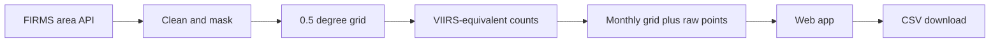

# Architecture and agent flow

NASA Space Apps: a burning-activity calendar from harmonized MODIS and VIIRS hotspots. Context: [project context](project-context.md), [plan](project-plan.md), [FIRMS findings](firms-download-requests.md), [Australia exploration](data-exploration.md).

## What we are building

A web app for emergency responders, scientists and land managers. The user picks an area and a date range and sees one consistent fire record from 2000 to the present: which months and years burned most, and how the current month compares with the historical median. The sensor that made each detection no longer matters.

## System architecture

- **Source.** FIRMS area API, key in `FIRMS_MAP_KEY_1`. Query a bounding box, then clip to the area. Standard-processing rows include `type`. The latest months are near-real-time and lack `type`; re-pull them when standard processing catches up. Public yearly files are a shortcut only, and not for MODIS before 2018.
- **Cleaning.** Keep vegetation fires. Apply one confidence rule per sensor. Drop days a satellite was not observing, using a daily availability mask.
- **Harmonization.** Count detections per 0.5° cell, split by day and night, and scale MODIS up to a VIIRS-equivalent count. Factors vary by region and month. Australia's national ratio is about 4.8, from about 4.4 in the west to 5.4 in the east. November 2000 to June 2002 (Terra only) gets its own factor. NOAA-20 and S-NPP are interchangeable, ratio about 0.98, so one VIIRS reference series is enough.
- **Product.** A gridded monthly series for the calendar, plus the raw points behind a search, both queryable by area and date. No login and no database beyond that store.
- **Web app.** Draw an area or enter coordinates, pick dates, then a year-by-month calendar on an accessible ramp (cividis), the current month against the historical median, anomalies versus the multi-year average, and a CSV of the hotspots in the search.

## Work breakdown

Done, and not reassigned:

- FIRMS download tool, on branch `cursor/firms-live-api-checks-93a8`.
- API evaluation: the area API is the source for all four sensors.
- Australia exploration: ratios, seasonality, outages, `type` inconsistency before 2018.

The EmberLedger team plan (Tunis, 14 Nov 2026) is the working plan. It targets Tunisia and Algeria north of 34°N, MODIS plus Suomi NPP, with a ratio per 0.5° cell and month. Their first result is 72% error with no conversion, 13.7% with one ratio, and 11.5% per area and month, fit on 2012–2019 and tested on 2020–2021. Australia stays a comparison, not the demo region. Day/night factors, the Terra-only years and the outage mask stay off the critical path until that 11.5% is reproduced.

Models are Grok and Composer only.

| Task | Depends on | Model |
| --- | --- | --- |
| Reproduce the Tunisia and Algeria conversion | their FIRMS files | `grok-4.7-xhigh` |
| Check it on the held-out years | conversion | `cursor-grok-4.6-high` |
| Rebuild the gridded product | validation | `composer-2.5` |
| Serve area queries and CSV export | product | `grok-4.7-high` |
| Build map, calendar and the raw/harmonized toggle | queries | `cursor-grok-4.6-xhigh` |
| Pack slides, references and the project page | app | `grok-4.7-medium` |
| Regenerate the product after the method locks | method locked | `composer-2.5-fast` |

## Agent flow

Each row is a separate agent on its own branch. It reads the docs linked above plus the previous agent's report, and writes its own report under ``

- **Conversion** (`grok-4.7-xhigh`). Reproduce the per-area, per-month ratio and the 11.5% figure on the real files. Strongest Grok setting for the scientific core.
- **Held-out check** (`cursor-grok-4.6-high`). A different Grok model, so the check is not graded by the one that ran the conversion.
- **Gridded product** (`composer-2.5`). Repeatable build: clean, grid, harmonize, write the monthly grid and the raw points.
- **Query and CSV** (`grok-4.7-high`). Area and date queries, and the CSV the app offers.
- **Web app** (`cursor-grok-4.6-xhigh`). Map, calendar, and the raw/harmonized toggle.
- **Submission pack** (`grok-4.7-medium`). Slides, references, project-page text. No new science.
- **Product regeneration** (`composer-2.5-fast`). Mechanical rerun once the method is locked. No new decisions.

The Project chat launches these. Dependent tasks run one after another. Two agents run at the same time only when they do not touch the same files, for example submission copy while a product rebuild is running.

## Still open

- Demo region is Tunisia and Algeria north of 34°N, from the EmberLedger plan. Australia is a comparison only.
- Agents use Grok and Composer only (`grok-4.7`, `cursor-grok-4.6`, `composer-2.5`). Opus, Fable, Sonnet, Gemini and GPT stay unused for now.
- Next step, when you say so: reproduce their 11.5% on the real files.
