# Data exploration: MODIS and VIIRS hotspots, pilot country Australia

Phase 0 of the [project plan](project-plan.md). Data comes from the public yearly per-country archive files: MODIS C6.1 for 2000-2025, VIIRS S-NPP for 2012-2025 and VIIRS NOAA-20 for 2018-2025. These are standard-processing (SP) files with the `type` column (see [FIRMS download findings](firms-download-requests.md)). The FIRMS API was not used.

The code is on repository branch `cursor/australia-eda-ede9`, under `analysis/`. To switch to another pilot country, run `python -m analysis all --region <ArchiveCountryName>`. Unless stated otherwise, every number below covers `type` 0 (presumed vegetation fire) only.

## Key findings for harmonization

1. **MODIS and VIIRS keep a near-constant ratio at the national monthly level.** S-NPP records about 4.8 times as many detections as MODIS Terra and Aqua combined. The median monthly ratio is 4.77 (interquartile range 4.59-5.00, coefficient of variation 12% over 167 months). The ratio barely changes with calendar month (medians 4.6-5.0) or with fire activity (4.7-5.0 from the quietest to the busiest fifth of months). One national scale factor already removes most of the sensor step.
2. **The two VIIRS sensors are interchangeable.** NOAA-20/S-NPP has a median of 0.98 (interquartile range 0.97-0.99), with r = 0.996 for log monthly counts. Both are VIIRS 375 m at the same overpass time. The only months that stray are those where one of the two has an outage. One VIIRS reference series is enough; average the sensors or fall back on whichever is available.
3. **Day and night must be calibrated separately, and the satellite mix matters.** S-NPP/MODIS is 3.9 by day and 7.7 by night. The night ratio is high because Aqua sees few night fires (14% of its detections are at night, versus 32% for Terra and 36% for VIIRS). S-NPP versus Aqua alone is 8.4 overall, about 6 by day and about 25 by night, with a seasonal cycle from 7.1 in winter to 9.4 in summer. Terra (10:30 and 22:30) and Aqua (13:30 and 01:30) see different parts of the daily fire cycle. Calibrate per satellite or per overpass, not on blended totals.
4. **The ratio varies in space, and thin cells are noisy.** For 0.5° cells over 2013-2025, the median cell ratio is 4.6, and the 10th-90th percentile spread is 3.4-6.2. The pooled ratio rises from west to east: 4.4 at 110-125°E, 5.4 at 145-155°E. It also differs by latitude zone and month, from 3.95 to 5.70 in the south and 4.4 to 5.8 in the tropics. The spread narrows as cells get busier, from 2.6-7.8 for cells with 20-49 MODIS detections to 4.2-5.5 for cells with at least 5000. 205 cells have VIIRS detections but no MODIS. Fit factors per region and month, and shrink thin cells toward the regional value instead of estimating a ratio per cell.
5. **Seasonality and anomalies are preserved.** Monthly log counts correlate at r = 0.990, and anomalies relative to each month's mean correlate at r = 0.980. Monthly climatology shares correlate at 0.998, and all sensors peak in October; 12 of 13 years share the same peak month. Per cell, monthly correlation has a median of 0.93, and 91% of active cells are at or above 0.8. A scaled MODIS series should give the same calendar shape as VIIRS.
6. **The Terra-only start needs its own factor.** Aqua begins on 2002-07-04, so November 2000 to June 2002 is Terra only. Terra+Aqua divided by Terra is 2.0 from November to January and 3.3 in April (2003 onward). This is a calendar-month factor of 2 to 3.3, not a constant.
7. **Outages produce the extreme monthly ratios.** Zero-detection days are 63 for Terra, 27 for Aqua, 41 for S-NPP and 7 for NOAA-20. The longest runs: Terra 2001-06-16 to 07-03 and 2022-10-11 to 10-23; Aqua 2022-04-01 to 04-16; S-NPP 2022-07-27 to 08-10 and several runs in mid-2024; NOAA-20 2023-07-19 to 07-22. The outlier months match these outages: 2022-04 at 8.6 (Aqua out), 2022-08 at 3.8 and 2024-07 and 2024-11 at 3.4 (S-NPP out). Partial outages, such as the low Aqua counts in 2020-08, are not zero-detection days but still distort the ratio. Harmonization needs a daily availability mask per satellite.
8. **`type` filtering is not stable across years. It removes 0.5% of MODIS and 1.1% of VIIRS records, but don't treat it as fixed.** The archive's MODIS `version` label is `6.2` up to the 2017 files, `6.03` for 2018-2022 and `61.03` for 2023-2025. The MODIS non-vegetation share roughly doubles at the 2018 switch, from about 0.45% a year to about 0.8%. The live API test found that the archive 2012-2017 MODIS rows are `6.2`, while the API returns the same detections as `6.03`. Between 1 and 8% of the sample rows were `type` 0 in the archive but `type` 2 (static source) in the API. Pre-2018 archive MODIS therefore uses an older static-source classification and keeps some industrial or gas-flare hotspots as vegetation fires. Before Phase 1: either re-derive `type` consistently, for example with one static-source cell mask applied to every sensor and year, or take MODIS 2012-2017 `type` from the API. Do not mix `type` from the two sources for those years.

## Data volume and coverage

| Sensor | Satellite codes | Records (all types) | First date | Last date |
|---|---|---|---|---|
| MODIS C6.1 | `Terra`, `Aqua` | 6,443,846 (Terra 2,955,709, Aqua 3,488,137) | Terra 2000-11-01, Aqua 2002-07-04 | 2025-12-31 |
| VIIRS S-NPP | `N` | 17,079,734 | 2012-01-20 | 2025-12-31 |
| VIIRS NOAA-20 | `N20` | 9,447,121 | 2018-04-01 | 2025-12-31 |

Every file's dates fall inside its file year. There are no exact duplicate rows. 12 S-NPP and 7 NOAA-20 rows repeat a location and time. No column has nulls.

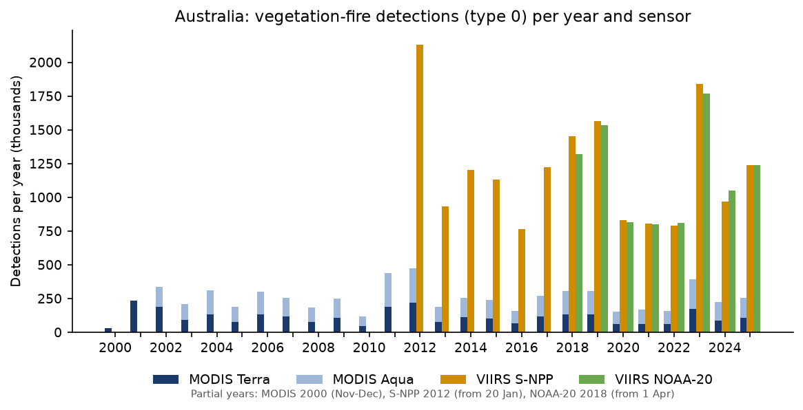

### Records per year, `type` 0

| Year | MODIS | Terra | Aqua | S-NPP | NOAA-20 |
|---|---|---|---|---|---|
| 2000 | 30,653 | 30,653 | | | |
| 2001 | 234,686 | 234,686 | | | |
| 2002 | 334,462 | 190,743* | 144,599* | | |
| 2003 | 211,380 | | | | |
| 2004 | 310,803 | | | | |
| 2005 | 188,277 | | | | |
| 2006 | 303,374 | | | | |
| 2007 | 253,693 | | | | |
| 2008 | 182,453 | | | | |
| 2009 | 250,861 | | | | |
| 2010 | 119,443 | | | | |
| 2011 | 436,085 | | | | |
| 2012 | 473,977 | | | 2,129,834 | |
| 2013 | 189,310 | | | 932,503 | |
| 2014 | 255,769 | | | 1,203,171 | |
| 2015 | 238,488 | | | 1,129,886 | |
| 2016 | 158,460 | | | 764,403 | |
| 2017 | 272,151 | | | 1,225,550 | |
| 2018 | 304,917 | | | 1,453,290 | 1,319,819 |
| 2019 | 308,430 | | | 1,562,240 | 1,535,960 |
| 2020 | 153,717 | | | 831,814 | 813,874 |
| 2021 | 170,392 | | | 805,022 | 797,977 |
| 2022 | 158,895 | | | 791,851 | 813,005 |
| 2023 | 394,189 | | | 1,840,477 | 1,767,770 |
| 2024 | 222,212 | | | 968,740 | 1,047,780 |
| 2025 | 254,031 | | | 1,240,016 | 1,236,288 |

\* Satellite split for 2002 is for all types. Aqua makes up 54-62% of MODIS records every year from 2003 onward. The full per-year split is in `modis_terra_aqua_by_year.csv`, and the year × month counts per sensor are in `counts_by_sensor_year_month*.csv` (see Reproduce).

## Burning calendars

Year by month counts of `type` 0 detections, with the cividis ramp on a log scale. Grey cells fall outside the sensor's record.

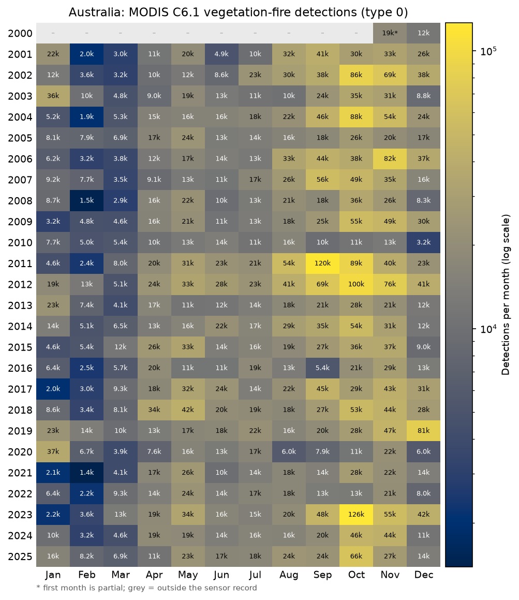

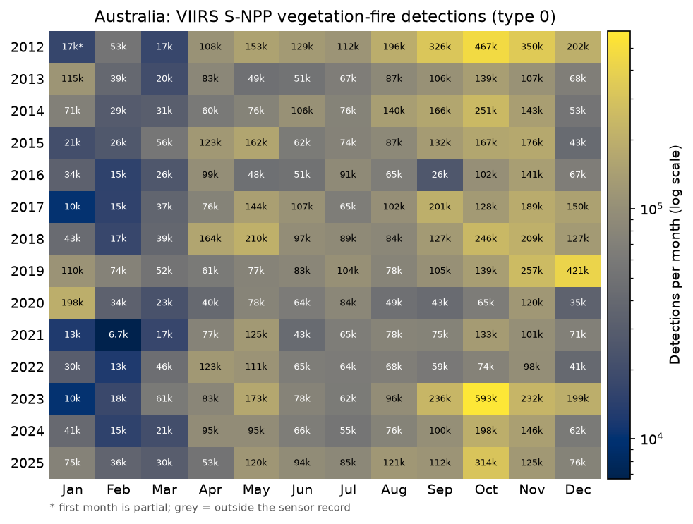

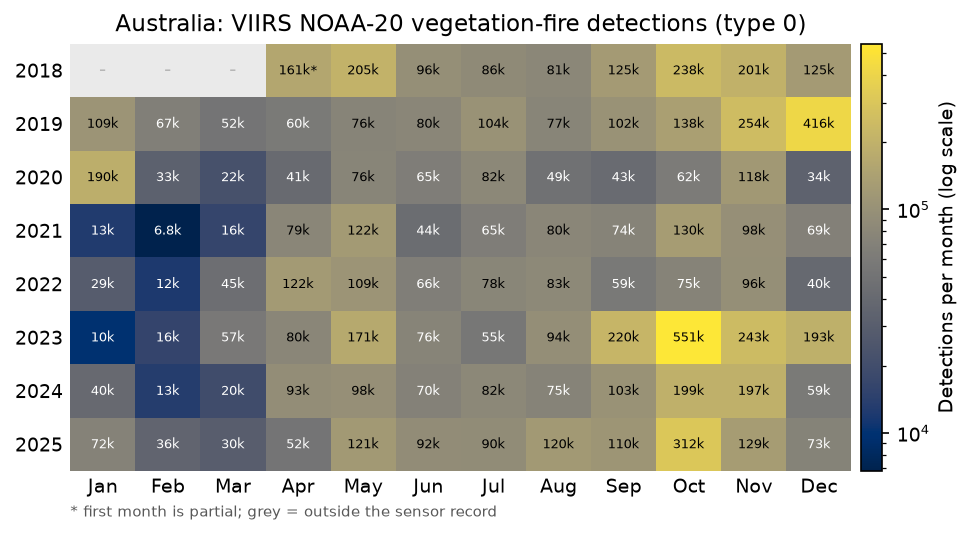

All three calendars show the same structure. The northern savanna fire season runs from April to November, with the national peak in September to November. February is the quietest month. The big years (2002, 2011-2012, 2019-2020 in the southeast, 2023) appear in every sensor. The ratio calendar below shows how even the S-NPP/MODIS ratio is. The cells that break the pattern are outage months.

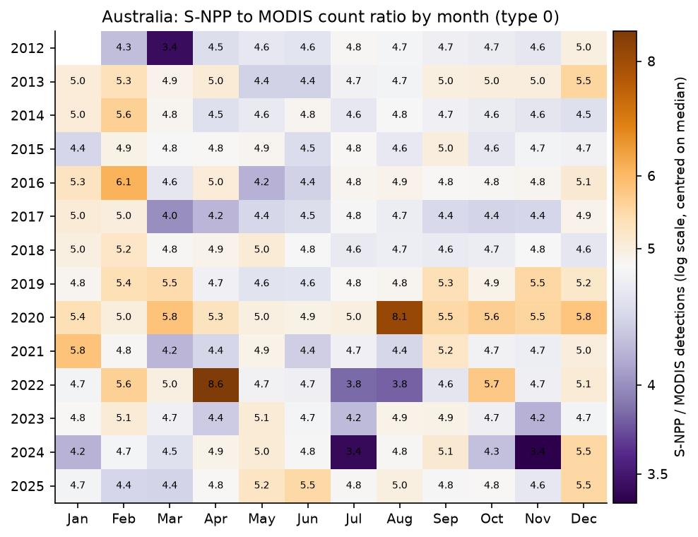

## Data dictionary

The archive CSVs have 15 columns. MODIS and VIIRS differ only in the brightness column names and in how `confidence` is encoded. Value ranges below are for Australia: minimum / 1st percentile / median / 99th percentile / maximum.

| Column | Meaning | MODIS C6.1 | VIIRS S-NPP / NOAA-20 |
|---|---|---|---|
| `latitude`, `longitude` | Centre of the fire pixel (degrees, WGS84). Not the exact fire location. | float; lat -43.6 to -9.2, lon 113.1 to 153.6 | float, 5 decimals; same extent |
| `brightness` / `bright_ti4` | Brightness temperature of the fire pixel (K). MODIS: 4 µm channel 21/22. VIIRS: I-4 (3.7 µm). | 300 / 301 / 329 / 411 / 509 | 208 / 297 / 338 / 367 / 367. **Saturates at 367 K** (9.9% of S-NPP rows, 8.7% of NOAA-20) |
| `bright_t31` / `bright_ti5` | Background brightness temperature (K). MODIS channel 31 (11 µm), VIIRS I-5 (11.45 µm). | 265 / 281 / 303 / 326 / 400 | 0 / 275 / 300 / 333 / 388. 37 S-NPP and 78 NOAA-20 rows hold 0, which looks like a fill value |
| `scan`, `track` | Pixel size along scan and along track (km). Grows away from nadir. | scan 1.0-4.8 (median 1.3, 24% > 2 km), track 1.0-2.0 | scan 0.32-0.80, track 0.36-0.78 |
| `acq_date` | Acquisition date (UTC) | 2000-11-01 to 2025-12-31 | 2012-01-20 / 2018-04-01 to 2025-12-31 |
| `acq_time` | Acquisition time, HHMM UTC, as a zero-padded string | 0000-2359 | 0227-1851 |
| `satellite` | Platform | `Terra`, `Aqua` | `N` (S-NPP), `N20` (NOAA-20) |
| `instrument` | Instrument | `MODIS` | `VIIRS` |
| `confidence` | Detection confidence | integer 0-100 (median 74). User-guide classes: low < 30, nominal 30-79, high ≥ 80. Large pile-up at exactly 100 | `l`, `n`, `h` |
| `version` | Collection and processing vintage | string: `6.2` (2000-2017 files), `6.03` (2018-2022), `61.03` (2023-2025). Read it as text; as a float, `6.2` and `61.03` lose their meaning | `2` |
| `frp` | Fire radiative power (MW) | -29.9 / 4.8 / 28.5 / 659 / 12,854. 4 negative values, 5,058 zeros | S-NPP -3.7 / 0.5 / 5.3 / 110 / 6,683. 155 negative values in S-NPP, 8 in NOAA-20 |
| `daynight` | `D` or `N`, based on solar zenith angle | D 77%, N 23% | D 64%, N 36% |
| `type` | 0 presumed vegetation fire, 1 active volcano, 2 other static land source, 3 offshore. Only in SP archive output | 0: 99.49%, 2: 0.48%, 3: 0.03%, no 1 | 0: 98.8%, 2: 1.1%, 3: 0.09%, no 1 |

Recommended load dtypes: float32 for coordinates and measurements, `acq_time` as text (then converted to an integer), `confidence` as Int8 for MODIS and as a category for VIIRS, `version` as text. MODIS FRP is about 3.6 times VIIRS FRP: the median for nominal and high confidence is 36.6 MW against about 10 MW. This is expected, because a 1 km pixel integrates more fire than a 375 m pixel. Do not pool FRP across sensors without the same kind of calibration as for counts.

## Day/night, overpass, confidence and `type`

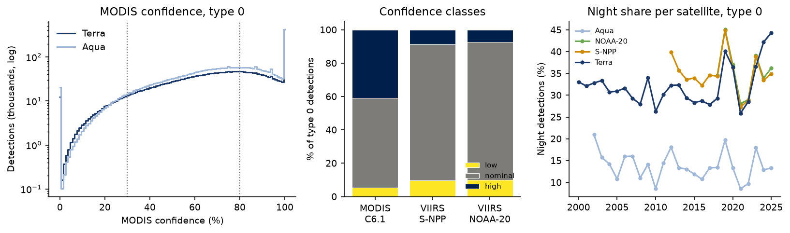

- **Confidence classes for `type` 0:**
  - MODIS: 5.3% low, 54.0% nominal, 40.7% high.
  - S-NPP: 9.7% low, 81.5% nominal, 8.8% high.
  - NOAA-20: 10.0% low, 82.6% nominal, 7.4% high.
  - VIIRS night detections are never classed low (98.5% nominal). The VIIRS `l` class exists only by day (15% of day detections).
  - The classes are not equivalent across sensors. Dropping low confidence from both moves S-NPP/MODIS from 4.77 to 4.55, so the threshold choice changes the factor.
- **Night share:** Terra 32%, Aqua 14%, S-NPP 36%, NOAA-20 37%. The share varies from year to year in step across sensors; it was low in 2010 and 2021 and high in 2019.
- **`type`:** Australia has no volcano class. Static land sources (`type` 2) are 0.5% of MODIS and 1.1% of VIIRS records, and offshore (`type` 3) is under 0.1%. The yearly non-vegetation share ranges from 0.2% to 1.2% for MODIS and 0.65% to 1.9% for VIIRS (`non_vegetation_share_by_year.csv`). It changes with the MODIS version (finding 8).

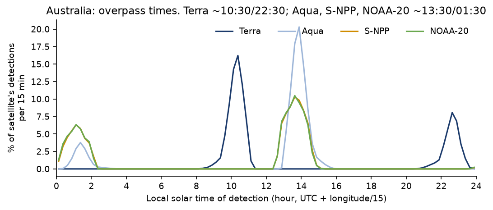

Local solar time is computed as UTC plus longitude/15. Terra crosses at about 10:30 and 22:30. Aqua, S-NPP and NOAA-20 all cross at about 13:30 and 01:30. MODIS's wide swath gives a broader spread of times.

## Data gaps

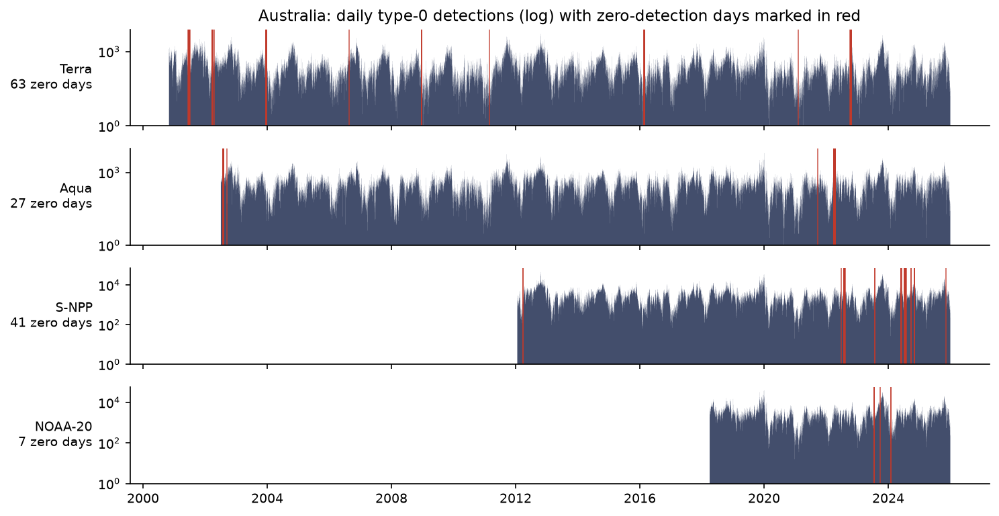

Australia has fires every day of the year, so a day with zero `type` 0 detections from a satellite almost certainly means the satellite has no data that day.

| Satellite | Record | Zero-detection days | Longest runs |
|---|---|---|---|
| Terra | 2000-11-01 to 2025-12-31 | 63 | 2001-06-16..07-03 (18 d), 2022-10-11..10-23 (13 d), 2002-03-20..03-28 (9 d), 2016-02-19..02-27 (9 d) |
| Aqua | 2002-07-04 to 2025-12-31 | 27 | 2022-04-01..04-16 (16 d), 2002-07-30..08-07 (9 d) |
| S-NPP | 2012-01-20 to 2025-12-31 | 41 | 2022-07-27..08-10 (15 d), 2024-07-10..07-15 (6 d), 2024-05-30..06-03 (5 d), 2024-07-25..07-28 (4 d) |
| NOAA-20 | 2018-04-01 to 2025-12-31 | 7 | 2023-07-19..07-22 (4 d) |

The full date lists are in `gap_days.csv`. The global missing-data list (`/api/missing_data`, summarised in the download findings) was not cross-checked here. That is a quick follow-up, because partial-day outages do not show up as zero days.

## MODIS vs VIIRS overlap (2012-02 to 2025-12)

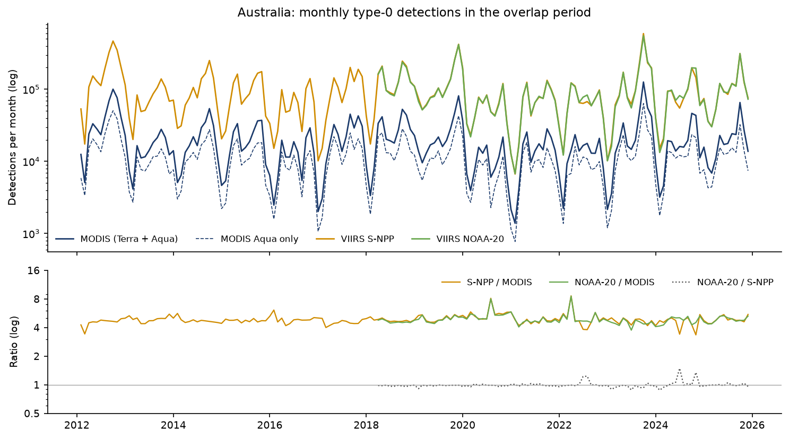

| Ratio (monthly, `type` 0) | Months | Median | P25-P75 | Min-Max | CV | Pooled |
|---|---|---|---|---|---|---|
| S-NPP / MODIS | 167 | 4.77 | 4.59-5.00 | 3.35-8.63 | 12% | 4.77 |
| S-NPP / MODIS Aqua | 167 | 8.42 | 7.25-9.24 | 4.52-21.5 | 22% | |
| NOAA-20 / MODIS | 93 | 4.77 | 4.55-5.08 | 3.76-8.55 | 13% | 4.79 |
| NOAA-20 / S-NPP | 93 | 0.98 | 0.97-0.99 | 0.88-1.49 | 8% | 0.99 |

| S-NPP / MODIS | Day | Night | All, low confidence dropped |
|---|---|---|---|
| Median monthly | 3.96 | 8.37 | 4.55 |
| Pooled | 3.93 | 7.67 | 4.55 |
| S-NPP / Aqua median | 6.04 | 25.45 | |

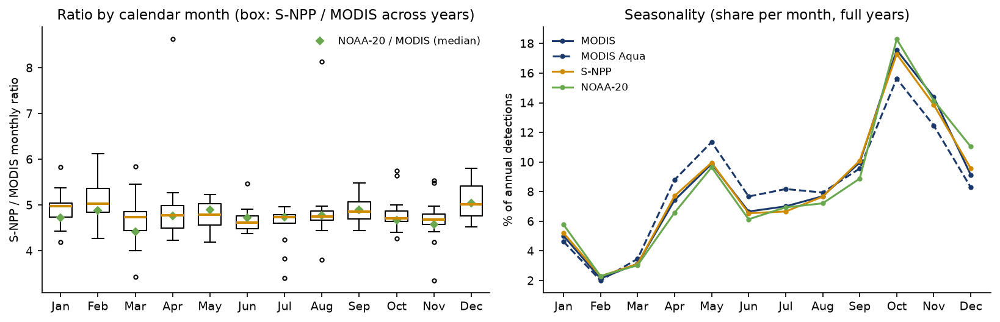

| Median ratio | Jan | Feb | Mar | Apr | May | Jun | Jul | Aug | Sep | Oct | Nov | Dec |
|---|---|---|---|---|---|---|---|---|---|---|---|---|
| S-NPP / MODIS | 4.97 | 5.03 | 4.73 | 4.77 | 4.79 | 4.62 | 4.73 | 4.75 | 4.86 | 4.70 | 4.69 | 5.02 |
| S-NPP / Aqua | 9.29 | 9.24 | 7.32 | 7.15 | 7.05 | 7.09 | 7.18 | 8.06 | 8.64 | 9.20 | 9.37 | 9.46 |
| NOAA-20 / S-NPP | 0.98 | 0.98 | 0.96 | 0.99 | 0.98 | 1.00 | 1.00 | 0.99 | 0.99 | 0.98 | 0.98 | 0.97 |
| Pooled S-NPP / MODIS, south of the Tropic | 5.15 | 5.31 | 4.60 | 4.08 | 3.95 | 4.57 | 4.54 | 4.94 | 5.70 | 5.49 | 5.29 | 5.37 |
| Pooled S-NPP / MODIS, tropics | 4.69 | 4.77 | 4.99 | 5.77 | 5.07 | 4.72 | 4.55 | 4.73 | 4.65 | 4.56 | 4.39 | 4.77 |

**Seasonality.** Seasonality is computed on full years: 2013-2025 for MODIS and S-NPP, 2019-2025 for NOAA-20.

| Metric | Value |
|---|---|
| Pearson r, log monthly counts (MODIS vs S-NPP) | 0.990 |
| Pearson r, monthly anomalies of log counts | 0.980 |
| Spearman r, monthly counts | 0.986 |
| Pearson r, monthly climatology shares | 0.998 |
| Years with the same peak month | 12 of 13 |
| Peak month (all sensors) | October (MODIS 17.6%, S-NPP 17.3%, NOAA-20 18.3% of the annual total) |
| Pearson r, log monthly counts (S-NPP vs NOAA-20) | 0.996 |

Aqua alone has a flatter seasonality than Terra+Aqua, with relatively more fire in April-July. Terra+Aqua matches the VIIRS seasonality better than Aqua alone, even though Aqua shares VIIRS's overpass time.

### Grid cells (0.5°, 2013-2025)

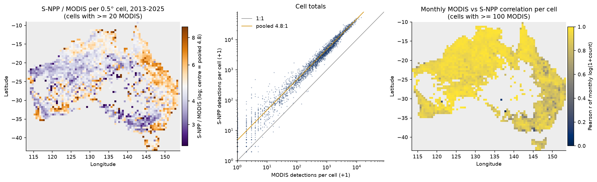

| MODIS detections per cell | Cells | Median S-NPP / MODIS | P10-P90 | Pooled |
|---|---|---|---|---|
| 20-49 | 164 | 4.53 | 2.57-7.78 | 5.00 |
| 50-199 | 357 | 4.49 | 3.17-6.75 | 4.76 |
| 200-999 | 918 | 4.49 | 3.39-6.23 | 4.61 |
| 1000-4999 | 818 | 4.66 | 3.64-6.01 | 4.83 |
| ≥ 5000 | 111 | 4.80 | 4.22-5.48 | 4.78 |

- 2,932 cells have at least one `type` 0 detection. 205 of them are VIIRS-only and 6 are MODIS-only.
- Pooled ratio by longitude: 110-125°E 4.41, 125-135°E 4.69, 135-145°E 4.74, 145-155°E 5.37.
- In the map, ratios are highest in the east (Queensland and New South Wales) and lowest in the west and interior.
- Per-cell monthly correlation (cells with at least 100 MODIS detections, 2,050 cells): median r = 0.93, and 91% of cells have r ≥ 0.8. The weaker cells are mostly in the southeast and in scattered interior cells, where fires are sparse.

## Implications for Phase 1

- **Calibrate at the overpass level.** Use VIIRS (S-NPP and NOAA-20 combined) as the reference. Fit MODIS-to-VIIRS factors separately by day and night, at least, and ideally by satellite (Terra, Aqua). Let them vary by region (for example a coarse zone or biome) and calendar month. Shrink cell-level estimates toward the zone factor.
- **Mask outages before fitting.** Build a daily availability mask per satellite from zero-detection days plus the FIRMS missing-data list. Exclude or rescale outage days before fitting and before computing calendars.
- **Bridge the Terra-only period (2000-11 to 2002-06)** with the month-specific Terra to Terra+Aqua factor (2.0-3.3).
- **Settle `type` and confidence rules before fitting.** Ratios shift by about 5% with the confidence threshold. `type` differs by MODIS version (finding 8).
- **Validate** by holding out years from 2012-2025 and checking for steps in 2012 and 2018. The national ratio is stable enough that a step larger than about 10% would point to a method problem.

## Reproduce

Repository branch `cursor/australia-eda-ede9`:

```bash
pip install -r requirements.txt
python -m firms_tool archive --sensors modis_c61 viirs_snpp viirs_noaa20 --years 2000-2025 \
    --countries Australia --out data/archive
python -m analysis all --region Australia
```

The tables (CSV, `tables.md`, `summary.json`) go to `data/eda/Australia/tables/` and the figures to `data/eda/Australia/figures/`. Raw and processed data is gitignored. A full run for Australia, about 33M rows, takes about 3 minutes.
