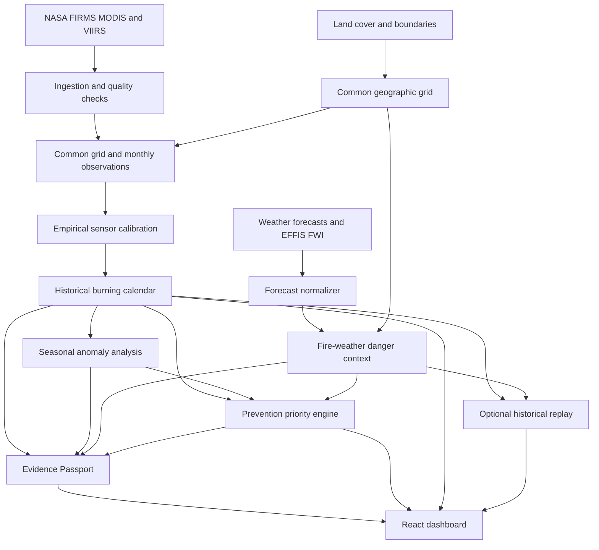

# EmberGuard AI — Complete Project Blueprint

**NASA Space Apps Challenge 2026**  
**Challenge:** Harmonization of MODIS and VIIRS Hot Spots  
**Project name:** EmberGuard AI  
**Tagline:** *From Satellite Data to Preventive Action*  
**Team:** Six developers  
**Pilot region:** Northern Tunisia, starting with the Bizerte area  
**Project type:** One integrated web application — not five separate projects

> **Mission:** Transform fragmented satellite fire observations and environmental forecasts into transparent, testable fire intelligence that helps land managers understand historical burning, identify periods of elevated fire-weather danger, and prioritize preventive attention.

**Scope note:** The required challenge deliverable is a harmonized historical burning-activity calendar. Forecasting, prevention planning, AI agents, and historical replay are added-value extensions. The team should not sacrifice a scientifically credible calendar to deliver more features.

---

## 1. Executive Summary

EmberGuard AI is an evidence-based fire intelligence and prevention-support platform. It integrates NASA MODIS and VIIRS active-fire observations into a more comparable historical burning-activity calendar, examines seasonal patterns and anomalies, combines that historical context with upcoming weather and land-cover information, and helps users prioritize areas for closer monitoring. An AI-assisted Evidence Passport explains what the data supports, what remains uncertain, and what follow-up checks are appropriate. A Historical Replay feature can test the monitoring approach against later satellite observations without leaking future data into past decisions.

The system targets forest managers, environmental researchers, land managers, agricultural advisers, and emergency-planning teams. It is **decision support, not an official emergency warning system**. It does not claim to predict exactly where a wildfire will ignite.

### The core user story

A forest manager in Bizerte chooses a region and asks: **“We have only two monitoring teams. Which areas should we examine tomorrow, why, and how reliable is the evidence?”**

EmberGuard responds through one connected workflow:

1. **Observe:** Display the area's NASA hotspot observations.
2. **Harmonize:** Explain MODIS–VIIRS comparability and show a historical burning calendar.
3. **Investigate:** Highlight unusual periods and the evidence behind them.
4. **Anticipate:** Show the next 24–72 hours of *fire-weather danger*.
5. **Prioritize:** Produce an explainable monitoring shortlist under the user's constraints.
6. **Review:** Generate an Evidence Passport with data sources, model checks, and limitations.
7. **Test (stretch goal):** Replay a past date and evaluate the proposed priorities against later observed activity.

### What makes this different

NASA FIRMS already supplies hotspot maps and data. Copernicus EFFIS already supplies fire-weather danger products. **EmberGuard's intended additional value is an auditable workflow that connects cross-sensor historical interpretation to practical, resource-constrained prevention planning**—then checks whether the conclusions are supported by data.

This is a **proposed innovation**, not a claim that no other product offers related functionality. Any statement of improved performance must be supported by measured comparisons.

---

## 2. Five Features at a Glance

| Feature | Problem | Core data | Method | Deliverable | Added value |
|---|---|---|---|---|---|
| **1. Fire Memory** | Incompatible satellite detection records | NASA FIRMS MODIS and VIIRS | Common grid/time aggregation; empirical cross-sensor calibration; seasonal baseline | Interactive harmonized burning calendar | Comparability, transparent sensor effects and critical periods |
| **2. Fire Time Machine** | Appealing predictions may not be useful | Historical fire activity, archived forecasts, land cover | Leakage-free historical replay; comparison with simple baselines | Before/after replay and evaluation | Demonstrable, testable decision value |
| **3. Fire Danger Radar** | Historical hotspots do not describe tomorrow's danger | Meteomatics/Open-Meteo, EFFIS FWI, land cover | Established fire-weather assessment plus contextual overlays | 24–72-hour danger map | Forecast conditions interpreted alongside historical context |
| **4. Prevention Studio** | Limited teams cannot monitor every zone equally | Danger assessment, history, land cover, optional exposure, user constraints | Transparent rule-based ranking; optional constrained optimization | Ranked monitoring shortlist and briefing | Turns data into an explicit planning decision |
| **5. AI Evidence Passport** | Complex results are hard to verify | Outputs and metadata from Features 1–4 | Claude tool calling or deterministic evidence workflow | Source-backed investigation report | Explainable conclusions and an explicit ability to withhold judgment |

**Recommended build order:** Feature 1 → Feature 3 → Feature 4 → Feature 5 → Feature 2. Time Machine is a high-impact stretch feature, not a blocker for the core demo.

---

## 3. Data Sources and How to Use Them

These are **data sources**, not interchangeable labels for the same quantity. Store source name, product/version, observation or issue time, spatial resolution, download date, and license/attribution information.

| Source | Official link | Fields or products | Use in EmberGuard | Integration priority |
|---|---|---|---|---|
| **NASA FIRMS — MODIS Collection 6.1** | https://firms.modaps.eosdis.nasa.gov/download/ | `latitude`, `longitude`, `acq_date`, `acq_time`, sensor/platform, `confidence`, `frp`, `daynight`, footprint context | Long-term active-fire observation record | **Required** |
| **NASA FIRMS — VIIRS 375 m (S-NPP)** | https://firms.modaps.eosdis.nasa.gov/download/ | Similar hotspot fields and VIIRS-specific metadata | Overlapping, higher-resolution observation record | **Required** |
| **Meteomatics Weather API** | https://www.meteomatics.com/en/weather-api/ | Forecast temperature, humidity, wind, gusts, precipitation | Next 24–72-hour weather context | High; hackathon offer if activated |
| **Open-Meteo Forecast API** | https://open-meteo.com/en/docs | Hourly forecast weather variables | Simple weather integration / fallback | High |
| **Open-Meteo Historical Weather** | https://open-meteo.com/en/docs/historical-weather-api | Historical meteorological estimates | Retrospective weather analysis; candidate training features | Optional |
| **Open-Meteo Historical Forecast** | https://open-meteo.com/en/docs/historical-forecast-api | Archived forecast-model data, subject to coverage | Historically honest replay when forecasts were available before decision time | Stretch |
| **Copernicus EFFIS** | https://forest-fire.emergency.copernicus.eu/applications/data-and-services | Canadian Fire Weather Index (FWI), danger classes, related fire products | Established danger assessment and baseline | High if access is easy |
| **ESA WorldCover** | https://esa-worldcover.org/en/data-access | Land-cover classes such as trees, crops, grassland, built-up | Environmental context and cell-level fractions | Medium |
| **NASA MODIS NDVI (MOD13Q1)** | https://ladsweb.modaps.eosdis.nasa.gov/missions-and-measurements/products/MOD13Q1/ | Vegetation index | Optional vegetation condition context | Optional |
| **NASA MODIS Burned Area (MCD64A1)** | https://ladsweb.modaps.eosdis.nasa.gov/missions-and-measurements/products/MCD64A1/ | Mapped burned area and approximate dates | Additional retrospective evaluation; not perfect ground truth | Optional |
| **NASA SMAP** | https://nsidc.org/data/spl4smgp | Soil moisture | Supporting drought context | Optional |
| **OpenStreetMap** | https://www.openstreetmap.org/ | Roads, settlements, infrastructure | Exposure context and planning constraints | Optional |
| **WorldPop** | https://www.worldpop.org/ | Population-distribution estimates | Human-exposure context | Optional |
| **geoBoundaries** | https://www.geoboundaries.org/api.html | Administrative boundary geometries | Region selection and spatial clipping | High |

**Minimal hackathon dataset:** MODIS + VIIRS + one geographic boundary + one weather-forecast source. Add EFFIS FWI and land cover if straightforward. Do not wait for every optional dataset before starting the application.

**Data caveats:**

- Active-fire **hotspots are detections of thermal anomalies**, not counts of individual wildfires or mapped fire perimeters. They may reflect wildfire, agricultural burning, or other thermal sources.
- MODIS and VIIRS differ in spatial resolution, sensitivity, overpass timing, and observation opportunities. Merely merging CSV rows or aggregating spatially is **not full harmonization**.
- Sensor-specific confidence values should not be treated as a single common numerical scale.
- Missing detections do not necessarily mean an area was observed and fire-free.
- Fire-weather danger does not equal the probability that a fire will ignite.
- Coarse weather/soil grids do not justify street-level risk precision.

---

## 4. Feature 1 — Fire Memory: Harmonized Historical Burning Calendar

### Problem

More than two decades of satellite observations exist, but MODIS and VIIRS do not record fire activity identically. Raw hotspot counts can make a real change look larger or smaller, or create an apparent change when the sensor mix changes. Users need a consistent, inspectable record of **when and where burning was observed**.

### Exact inputs

- **MODIS:** detection location, acquisition date/time, satellite, confidence, fire radiative power (FRP), day/night, pixel footprint information.
- **VIIRS:** analogous detection fields plus product-specific quality metadata.
- **Region/grid:** a Bizerte/northern Tunisia polygon, divided into a common spatial grid. Start with roughly **20–25 km cells** to avoid excessively sparse monthly data; refine only if justified.
- **Optional:** land cover to compare observations associated with forests, cropland, or other classes. These associations are not definitive cause labels.

### Exact processing steps

1. **Ingest:** Download science-quality historical records from FIRMS where available. Begin with a manageable overlapping period such as **2022–2024**, then expand if time allows.
2. **Validate:** Parse dates and units, flag invalid coordinates and missing fields, preserve sensor IDs and original records, and avoid removing genuine repeated observations as if they were accidental duplicate CSV rows.
3. **Spatially align:** Assign every detection to `grid_id` using the same geographic grid. Keep the native position for map exploration.
4. **Temporally align:** Group observations by `grid_id`, month, and sensor; calculate hotspot detections and days with at least one detected hotspot.
5. **Build a baseline:** Display independent raw MODIS and VIIRS series. These remain available even if the calibration fails.
6. **Empirically calibrate:** Fit a simple regression (e.g., Ridge or Poisson regression) on paired overlapping months, with sensor and seasonal context where appropriate. Choose a documented reference scale and do not interpret it as the true fire count.
7. **Validate:** Train on earlier months/years and test on later months/years. Compare error or seasonal bias against a trivial calibration or uncorrected-count baseline; show uncertainty and problematic cases.
8. **Detect anomalies:** Compare a month's harmonized activity with previous observations from the **same season**. Use median and median absolute deviation (MAD) or another clearly defined robust seasonal statistic. Label very sparse/uncertain cells appropriately.
9. **Publish:** Store the resulting activity and calibration diagnostics with versioned provenance.

### Models and algorithms

- **Required:** basic grid/time aggregation, empirical cross-sensor calibration, seasonal baseline.
- **Recommended starting model:** Ridge regression or Poisson regression (Poisson is appropriate only if its assumptions and diagnostic behavior fit the count target).
- **Optional:** Isolation Forest for multivariate anomalies, but only if you have enough data and can justify it against the seasonal baseline.

### Output schema

`historical_activity.parquet` (one row per grid cell and month):

```text
grid_id, month, modis_count, viirs_count, modis_active_days,
viirs_active_days, harmonized_activity_index, seasonal_anomaly_score,
calibration_version, quality_flags
```

### What the application shows

- Interactive **calendar heatmap** of observed burning activity.
- **Sensor Truth Mode:** switch between raw MODIS, raw VIIRS, and the calibrated activity index.
- Historical timeline, seasonal comparisons and hotspot map.
- Warning labels where conclusions depend strongly on sensor treatment or limited observations.

### Added value compared with existing products

**Existing:** FIRMS makes active-fire observations discoverable and mappable.  
**EmberGuard:** Offers an evidence-audited, cross-sensor **calendar of comparable observed activity** with explicit uncertainty and the ability to inspect why a historical anomaly was flagged.

### Acceptance test

A judge can select one region, view all three sensor modes, inspect one unusual month, and see a real held-out calibration comparison. If the calibration is weak, the interface says so instead of claiming success.

---

## 5. Feature 2 — Fire Time Machine: Blind Historical Replay

**Priority:** Stretch feature after the working calendar, danger view and prevention shortlist.

### Problem

A colorful danger map is not proof that a method would have made useful decisions. Users need a way to see whether the historical evidence would have highlighted areas that later showed elevated burning activity.

### Exact inputs

- Historical hotspot observations and historical activity index from Feature 1.
- Fire-weather indicators and **archived forecasts issued before the replay date**, if available.
- Dated land-cover/vegetation information with appropriate temporal assumptions.
- Later satellite observations for the evaluation outcome **only**.

### Exact processing steps

1. User selects a past date and a region.
2. Freeze the analytical inputs to what was available **at or before** that date.
3. Run the same prioritization method used by Prevention Studio.
4. Record the ranked zones and all input timestamps.
5. Reveal satellite detections in a defined future window (e.g., the following seven days).
6. Compare actual later observed activity with the previous shortlist.
7. Repeat over multiple held-out historical dates and compare with a simple baseline such as EFFIS/FWI-only ordering.

If only historical weather **reanalysis** is available, label the demonstration a retrospective hindcast/analysis—not a faithful archived operational forecast.

### Models and metrics

- Use the existing prioritization model from Feature 4, not a second hidden model.
- Evaluate precision at the top `k` zones, recall of future elevated satellite-observed activity, and results relative to the baseline.
- Treat subsequent *satellite detections* as the outcome; they are not a complete census of ignitions.

### What the application shows

A **Before → Reveal → Evaluate** interaction: show historical inputs and recommendations first, then reveal later observations and the performance summary.

### Added value compared with existing products

**Existing:** Historical maps allow users to look backward.  
**EmberGuard:** Lets users **test** a monitoring strategy rather than only viewing its claims. This is potentially the strongest credibility-building demo if implemented without future-data leakage.

### Acceptance test

One replay case can be reproduced from saved inputs and correctly distinguishes decision-time evidence from later outcome data. Do **not** claim improvement unless tested against the baseline.

---

## 6. Feature 3 — Fire Danger Radar: Next 72 Hours

### Problem

Hotspot records describe observed burning, not tomorrow's meteorological danger. Managers need upcoming weather conditions interpreted in a specific environmental and historical context.

### Exact inputs

- **Forecast:** hourly temperature, relative humidity, wind speed, wind gusts and precipitation from Meteomatics or Open-Meteo.
- **Established indicator:** EFFIS Canadian Fire Weather Index (FWI) and danger classifications, when accessible.
- **Land cover:** ESA WorldCover forest/crop/grassland/built-up fractions by `grid_id`.
- **Historical context:** Feature 1's seasonal activity index and quality flags.
- **Optional:** NASA MODIS NDVI or SMAP soil-moisture context.

### Exact processing steps

1. Create a `grid_id` list with cell centers and boundaries.
2. Retrieve the upcoming 72 hours of hourly weather for a **limited selection of points/cells**; record forecast issue time and valid time.
3. Derive daily summaries: highest temperature, lowest relative humidity, highest wind/gust and total precipitation.
4. If available, join official EFFIS FWI for matching date/location. Preserve its native resolution and class definitions.
5. Join land-cover fractions and historical context without collapsing all sources into an unexplained score.
6. Show meteorological fire danger and contextual flags **separately**. For example: `HIGH FWI`, `TREE COVER`, `HISTORICALLY ACTIVE SEASON`.
7. Add missing-data indicators and avoid precise map boundaries unsupported by the input grids.

### Models and algorithms

- **Primary:** established **Canadian Fire Weather Index**, preferably via EFFIS rather than an improvised weighted formula.
- **Optional ML experiment:** Random Forest or gradient boosting to estimate a precisely defined target such as elevated *future observed hotspot activity*, trained only from pre-target inputs and evaluated on later dates. Never label this an exact wildfire ignition probability without further validation.

### Output schema

```text
grid_id, forecast_issue_time, valid_date, temperature_max,
humidity_min, wind_max, gust_max, rainfall_total, fwi_value,
fwi_danger_class, forest_fraction, historical_context, quality_flags
```

### What the application shows

- Map with day-1/day-2/day-3 selection.
- Click a cell for weather, FWI, vegetation, historical burning and data quality.
- Distinction between **forecast danger** and **historical observations**.

### Added value compared with existing products

**Existing:** EFFIS and weather services already present forecasts and danger products.  
**EmberGuard:** Brings that danger into the *same analytical location and workflow* as harmonized NASA fire history, enabling interpretable monitoring decisions.

### Acceptance test

Click a zone and obtain real forecast values with source, time, danger classification (if available), and a meaningful historical comparison. No fabricated probabilities.

---

## 7. Feature 4 — Prevention Studio: Prioritize Limited Monitoring Resources

### Problem

A manager may need to monitor many places while having only a few teams. A red danger map does not automatically answer **“Which zones deserve review first?”**

### Exact inputs

- Feature 3: FWI/fire-weather danger and contributing weather variables.
- Feature 1: historical seasonal activity and uncertainty.
- ESA WorldCover: land cover and potentially burnable vegetation context.
- Optional OSM/WorldPop: roads, settlements, population or critical infrastructure (subject to coverage and license checks).
- User input: number of teams, selected period, region and planning objective.
- Feature 5: scientific confidence and missing-data warnings.

### Exact processing steps

1. **Create candidate zones** from the common geographical grid.
2. **Separate factors:** fire-weather danger, vegetation context, historical activity, exposure and data quality.
3. **Use transparent priorities:** Begin by sorting candidates by established fire-weather danger. Use historical/land-cover context to break ties or flag additional review needs. If the user prioritizes population exposure, show that as an explicit different objective.
4. **Respect constraints:** Select only as many candidate zones as the user has monitoring teams; do not invent road travel time or patrol capacity.
5. **Explain every selection:** Provide the exact fields and rules that put a zone on the shortlist.
6. **Display what's not selected:** Show remaining high-concern zones and any missing information.
7. **Generate a briefing:** Recommended *monitoring and preparedness checks*, not automated emergency dispatch commands.

### Model and algorithm

- **Required:** interpretable multi-criteria ranking using a documented decision table or lexicographic ordering. Avoid invented numerical ignition probabilities.
- **Optional:** constrained optimization if real operational constraints and evaluation are available.

### Output schema

`prevention_plan.json`:

```json
{
  "region": "Bizerte pilot area",
  "forecast_date": null,
  "available_teams": 2,
  "objective": "fire_weather_monitoring",
  "selected_grid_ids": [],
  "unselected_grid_ids": [],
  "ranking_reasons": {},
  "data_limitations": [],
  "sources": []
}
```

### What the application shows

- A slider for number of monitoring teams.
- A planning-objective selector (weather danger, historical activity, exposed settlements).
- Ranked zones, reasons, warnings and **areas left unmonitored**.
- Exportable monitoring/prevention briefing.

### Added value compared with existing products

**Existing:** Users inspect hazard maps and manually combine information.  
**EmberGuard:** Produces an **auditable, resource-aware monitoring shortlist** with a clear explanation of the assumptions and trade-offs.

### Acceptance test

Changing the team count or priority changes the shortlist predictably. Users can inspect why each zone is included and no unsupported claim of optimal deployment is made.

---

## 8. Feature 5 — AI Evidence Passport: Evidence-Based Investigation

### Problem

Environmental conclusions can look authoritative even when data are missing or sensor assumptions are weak. A general chatbot may explain confidently without calculating or validating anything.

### Exact inputs

No separate science dataset is required. Consume:

- Original MODIS/VIIRS records and Feature 1 analysis.
- Feature 2 replay outcomes, if available.
- Feature 3 weather forecasts and danger assessments.
- Feature 4 ranking reasons and constraints.
- Data source metadata, calibration metrics, quality flags and timestamps.

### Model and architecture

**Option A — Claude tool calling (if you have usable API access):** One orchestrator coordinates three bounded specialist roles.

1. **Investigator:** Retrieves measurements and relevant time periods.
2. **Scientific Analyst:** Calls deterministic Python tools for comparisons, anomalies and evaluation.
3. **Evidence Reviewer:** Checks whether the written conclusion follows from the results; can request predefined tests or abstain.

**Option B — Deterministic fallback:** Produce structured Evidence Passports directly from trusted Python calculations and templates. This works without an LLM and should always be the backup.

**Important:** Claude being available for coding does not automatically mean the application has Claude API credentials. Confirm availability before treating an LLM as essential.

### Approved tools

```python
get_historical_activity(grid_id)
compare_modis_viirs(grid_id)
get_harmonization_metrics(grid_id)
check_seasonal_anomaly(grid_id, period)
get_weather_forecast(grid_id, day)
get_danger_context(grid_id, day)
get_prevention_plan(region_id, objective, teams)
validate_evidence(report_id)
```

The LLM never creates scientific measurements. Tools return typed data and source IDs; the report must refer to those outputs.

### Output schema

```json
{
  "grid_id": "G001",
  "question": "Why is this area prioritized?",
  "observations": [],
  "model_results": [],
  "supporting_sources": [],
  "quality_warnings": [],
  "conclusion": null,
  "confidence_statement": "Insufficient data for assessment",
  "recommended_follow_up": []
}
```

### What the application shows

An **Investigate** button opens an Evidence Passport containing:

- Question and selected zone.
- Raw observations, derived metrics and dates.
- Interpretation of fire-weather concern and historical context.
- Cross-sensor caveats and model-quality information.
- Reviewer findings, missing evidence and a cautious next step.

### Creative interaction — Scientific Challenge Mode

The analyst detects an apparent increase in activity; the reviewer asks if the result survives a sensor-comparability check; the passport either retains, qualifies or rejects the claim. This is more useful than several agents merely agreeing with each other.

### Added value compared with existing products

**Existing:** Chatbots generate natural-language descriptions.  
**EmberGuard:** Produces **traceable and challengeable explanations** based on actual tools, with the option to state that evidence is insufficient.

### Acceptance test

A selected zone produces a report where every numerical assertion traces to a stored tool result; missing data are reported rather than invented.

---

## 9. Shared Application Architecture



### Shared keys and constraints

- `grid_id`: common geographical cell ID.
- `observation_time`: when a satellite actually observed a hotspot.
- `forecast_issue_time`: when the forecast was issued.
- `forecast_valid_time`: when the forecast is intended to apply.
- `source_id` / `dataset_version`: provenance.
- `quality_flags`: missingness, limited coverage, calibration sensitivity, etc.

### Suggested project layout

```text
emberguard/
├── README.md
├── data/
│   ├── raw/                         # Original immutable source files
│   └── processed/                   # Versioned derived files
├── backend/
│   ├── main.py                      # FastAPI entrypoint
│   ├── schemas.py                   # Shared typed API contracts
│   ├── ingestion.py
│   ├── harmonization.py
│   ├── anomalies.py
│   ├── weather.py
│   ├── danger.py
│   ├── prevention.py
│   ├── evidence.py
│   └── replay.py                   # Optional
├── frontend/                       # React + Vite + Leaflet + charts
├── tests/
│   ├── test_harmonization.py
│   ├── test_no_future_leakage.py
│   ├── test_prevention.py
│   └── test_api.py
└── docs/
    ├── methodology.md
    ├── data_sources.md
    ├── model_evaluation.md
    └── demo_script.md
```

### Minimal API endpoints

| Endpoint | Inputs | Returns |
|---|---|---|
| `GET /api/regions` | Optional search/filter | Supported region and grid metadata |
| `GET /api/history` | Region/grid and date range | Monthly activity and anomaly series |
| `GET /api/sensors/compare` | Region/grid and date range | Raw series, calibrated series, quality diagnostics |
| `GET /api/danger` | Region/grid and forecast day | Weather, danger and vegetation context |
| `POST /api/prevention/plan` | Region, date, team count, objective | Ranked zones, explanations and limitations |
| `POST /api/investigate` | Region/grid or plan ID | Evidence Passport |
| `POST /api/replay` | Historical date, region, constraints | Replay result and evaluation (optional) |

### Recommended stack

- **Data/science:** Python, Pandas, NumPy, SciPy, scikit-learn.
- **Spatial:** GeoPandas and optional raster processing; keep the main demo on a simple 2D grid.
- **Storage:** Parquet and DuckDB, or compact CSV for the MVP.
- **API:** FastAPI and Pydantic.
- **Frontend:** React, Vite, Leaflet, Recharts.
- **AI:** Claude tool calling, only if practical, with a deterministic fallback.
- **Testing:** Pytest and saved small-data fixtures.
- **Deployment:** A publicly accessible frontend and backend, with an offline/demo-data fallback that is explicitly identified.

---

## 10. Evaluation: How to Prove Added Value

Your judging guide uses **Impact, Creativity, Validity, Relevance, and Presentation**. Build evidence for each; do not present hypothetical performance as measured success.

| Claim | Baseline | Evaluation | Honest interpretation |
|---|---|---|---|
| Harmonization improves comparability | Raw counts or simple seasonal scale factor | Held-out period bias/error relative to named reference sensor | Better alignment, not true fire-count accuracy |
| Anomalies are meaningful | Same-season historical baseline | Robustness to sensor choice, time windows and sparse cells | Unusual *observed* activity, not necessarily a confirmed wildfire event |
| Fire danger is credible | Official EFFIS FWI/class | Agreement with source for matched dates/areas | Fire-weather danger, not ignition probability |
| Prioritization adds information | FWI-only zone ranking | Held-out top-k precision/recall for later observed activity, where feasible | Evidence for improved prioritization only if measured |
| AI interpretation is trustworthy | Template based on raw numbers | Automated claim-to-source checks; abstention test | Traceable explanation, not independent physical validation |
| Replay supports decisions | Seasonal or FWI-only method | Reproducible historical scenarios without future leakage | Retrospective evaluation, not evidence of real-world lives saved |

### Mandatory scientific guardrails

1. Do not equate a hotspot with an individual wildfire.
2. Do not infer that a missing detection means a location was definitely fire-free.
3. Do not call a simple grid aggregate a fully harmonized multi-sensor product.
4. Do not interpret historical sensor agreement as independent ground truth.
5. Do not report unvalidated ignition probabilities or street-level precision.
6. Do not use post-date observations in a historical prediction/replay model.
7. Do not instruct emergency teams to deploy automatically or claim official authority.
8. Cite sources, product versions, methods and material limitations.

---

## 11. Hackathon Priorities and Six-Person Work Split

### Must-have MVP (complete before polishing)

1. Real NASA MODIS and VIIRS observations for one region.
2. A selectable, working historical burning calendar.
3. Raw vs. harmonized comparison and at least one honest evaluation.
4. A basic 72-hour weather-danger context view.
5. A simple transparent monitoring shortlist.
6. A source-linked Evidence Passport or reliable deterministic report.
7. A public working demo and complete submission.

### Stretch goals

- Historical blind replay.
- More extensive land-cover and population exposure.
- A trained and backtested future-activity ML model.
- Multiple fully autonomous tool-using AI agents.
- Advanced patrol optimization.

### Team assignment

| Developer | Ownership | First deliverable |
|---|---|---|
| **1 — Data Engineer** | FIRMS archival ingestion and data quality | Clean, documented MODIS/VIIRS sample and grid mapping |
| **2 — Scientific/ML Engineer** | Calibration, seasonal anomalies, evaluation | Tested `historical_activity` output |
| **3 — Weather Engineer** | Forecast and FWI ingestion | Real per-cell 72-hour danger context |
| **4 — Backend/AI Engineer** | FastAPI contracts, investigation tools | Working endpoints and Evidence Passport |
| **5 — Frontend Engineer** | Unified map, calendar, comparison charts | Usable React application |
| **6 — Integration/Product Lead** | Prevention rules, test integration, pitch and submission | Working prioritized shortlist and demo |

**Integration rule:** Agree on `grid_id`, datetime representation, response schemas and sample JSON **before** developing in parallel. Each team member should provide a fixture and a test for their module.

### Practical execution sequence

1. **First:** Obtain real NASA observations and confirm overlapping dates.
2. **Next:** Display original MODIS and VIIRS counts using the shared grid.
3. **Next:** Add a baseline calibration and measurement caveats.
4. **Next:** Integrate weather forecasts and established FWI when available.
5. **Next:** Produce a transparent prevention shortlist.
6. **Next:** Generate one evidence-backed report.
7. **Only then:** Add replay, more agents, extra datasets and polished interactions.

If a model or external API fails, retain a working baseline and state the limitation. A reliable, narrow demo is stronger than five partially implemented promises.

---

## 12. Judge-Facing Demo and Pitch

### The one scenario to show

A judge opens EmberGuard and selects **Bizerte, Tunisia**.

1. **Historical context:** A calendar reveals seasonal burning activity; Sensor Truth Mode shows raw MODIS, raw VIIRS, and calibrated results.
2. **Upcoming conditions:** The same area displays a timestamped fire-weather outlook and vegetation context.
3. **Decision:** The user enters **two available monitoring teams**; Prevention Studio selects two zones and clearly explains why.
4. **Trust:** The judge clicks **Investigate** and sees the Evidence Passport, including sources, uncertainty and an appropriate preventive follow-up.
5. **Proof (optional):** Replay a historical date, reveal later observations and compare against a simple baseline.

### 30-second demo storyboard

| Time | Message | Visual |
|---|---|---|
| 0–5 s | “Two satellites observe fires differently.” | MODIS/VIIRS comparison |
| 5–12 s | “We make historical burning patterns comparable.” | Harmonized calendar |
| 12–19 s | “We connect history to upcoming weather danger.” | 72-hour contextual map |
| 19–25 s | “Limited monitoring teams need clear priorities.” | Ranked shortlist |
| 25–30 s | “Every conclusion comes with evidence and uncertainty.” | Evidence Passport |

Use a real project output wherever possible; identify any illustrative screenshots or hypothetical examples as such.

### NASA Space Apps Tunis deadlines and submission requirements

According to the team's supplied 2026 opening-ceremony and project-submission guides:

- **Sunday, November 15, 2026, 16:30 (Tunis time):** Local project submission.
- **17:00:** Local judging; **7-minute pitch and 3-minute Q&A**.
- **23:59:** Final online “Submit for Judging” deadline (Tunis time).
- **Submission:** 50–200-word high-level summary, project details, public project link, and **one** public demo link (video of at most **30 seconds**, or slides of at most **seven slides**).
- **Global eligibility:** Include at least one NASA challenge data resource, with links.
- **Transparency:** Disclose AI use, label AI-generated media where required, and credit code, data, images and other resources. Avoid unauthorized NASA branding in generated media.

Confirm the final local organizer instructions before submission.

### Award positioning

- **Best Use of Data:** Credible access and harmonization of MODIS/VIIRS history.
- **Best Use of Science:** Sound assumptions and reproducible evaluation.
- **Best Use of Technology:** Useful, bounded, evidence-aware AI workflows.
- **Local Impact / Galactic Impact:** A clear, realistic prevention-planning use case for northern Tunisia.

These are possible narratives, **not** guaranteed award outcomes.

---

## 13. Definition of Done

Use this as the team’s final checklist:

- [ ] Both MODIS and VIIRS historical datasets are real and source-attributed.
- [ ] All views share the same geographic cell IDs and clear time definitions.
- [ ] Calendar and original sensor comparison work end-to-end.
- [ ] Harmonization method and holdout results are documented.
- [ ] Anomaly detection has a seasonal baseline and uncertainty warning.
- [ ] Forecast danger values have sources and issue/valid timestamps.
- [ ] Prevention ranking is transparent and responds to user constraints.
- [ ] Evidence Passport links quantitative claims to stored tool results.
- [ ] No claims of exact wildfire ignition prediction or official emergency authority.
- [ ] The application runs from a public link without login.
- [ ] Demo meets the 30-second video or seven-slide limit.
- [ ] AI use, licenses, datasets and code sources are disclosed.
- [ ] Submission is saved, checked, and submitted on time.

---

## 14. Final Value Proposition

> **“FIRMS tells us what satellites observed. Fire-weather services tell us where conditions may be dangerous. EmberGuard connects that information into a transparent, testable prevention decision—and shows the evidence behind it.”**

The most compelling project is not the one claiming the largest number of models or agents. It is the one that demonstrates a working NASA-centered scientific contribution, a meaningful decision for a real user, honest validation, and a clear story within the hackathon deadline.

### Primary reference links

- NASA FIRMS: https://firms.modaps.eosdis.nasa.gov/
- NASA FIRMS archive: https://firms.modaps.eosdis.nasa.gov/download/
- Copernicus EFFIS: https://forest-fire.emergency.copernicus.eu/
- Meteomatics: https://www.meteomatics.com/en/weather-api/
- Open-Meteo: https://open-meteo.com/en/docs
- ESA WorldCover: https://esa-worldcover.org/en/data-access
- NASA MOD13Q1: https://ladsweb.modaps.eosdis.nasa.gov/missions-and-measurements/products/MOD13Q1/
- NASA MCD64A1: https://ladsweb.modaps.eosdis.nasa.gov/missions-and-measurements/products/MCD64A1/
- OpenStreetMap: https://www.openstreetmap.org/
- WorldPop: https://www.worldpop.org/
- geoBoundaries: https://www.geoboundaries.org/api.html

