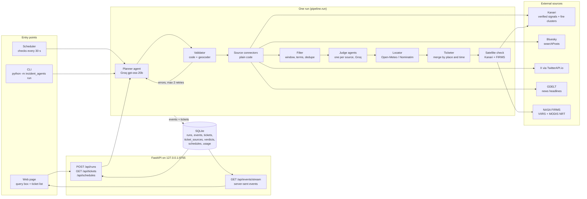
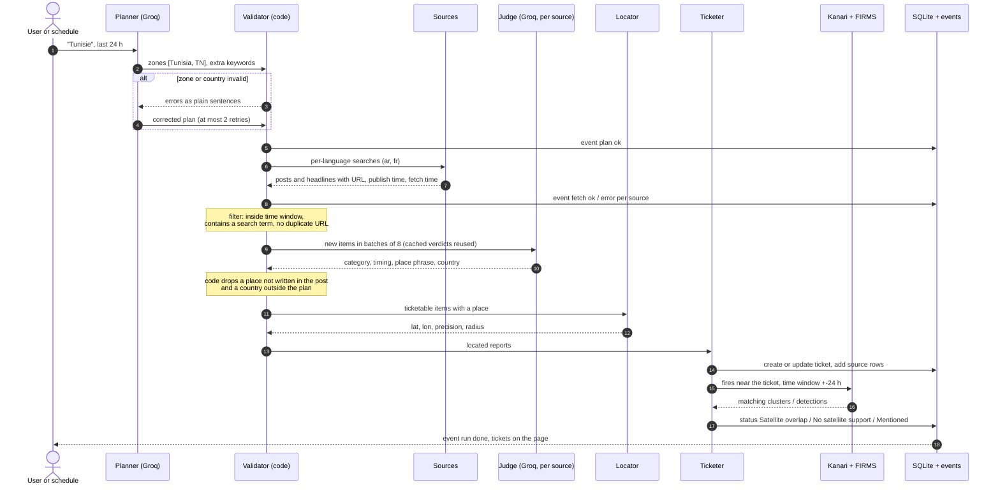
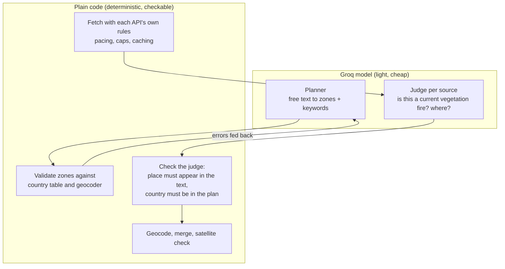
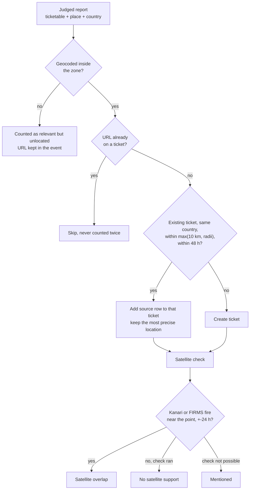
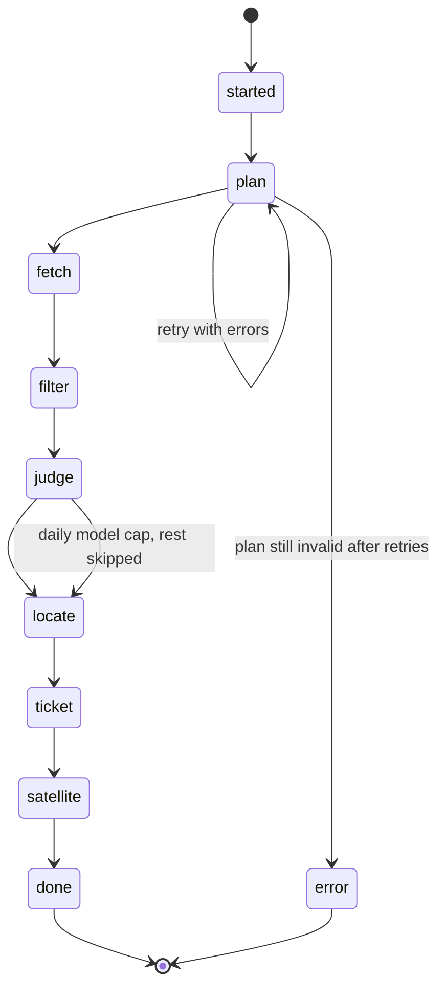

# Fire incident agents: architecture and flow

This document explains how the incident agents in [`incident_agents/`](../incident_agents/) turn a typed request ("Tunisie", "Kabylie, Algeria", "Var et Bouches-du-Rhône") into incident tickets.

Each ticket lists the sources that reported it, with links. A satellite check then marks each ticket as backed by satellite data or not. For setup, commands and limits, see [`incident_agents/README.md`](../incident_agents/README.md).

**Tickets are unverified public mentions.** They are not official alerts, and the tool never dispatches anyone.

## 1. The big picture

The system has three layers:

- **Entry points:** you type a query on a local page, or a saved schedule fires.
- **The run pipeline:** one Groq model call plans the search, plain code fetches from each source, and a Groq judge agent per source reads the posts.
- **Storage:** everything lands in one SQLite file. Every step also writes an event that the page shows live.

## 2. One run, step by step

### What each step does

| # | Step | Who | Input | Output | Event shown on the page |
|---|---|---|---|---|---|
| 1 | **plan** | Groq `openai/gpt-oss-20b`, strict JSON schema | The free text, in any language | Zones (name, ISO-2 country, kind) and extra keywords per language | `plan · ok  Tunisia (TN)` |
| 2 | **validate** | Code | The model's plan | Each zone resolved to a bounding box. Countries use a built-in mainland table, and regions go through Nominatim. | `plan · running … attempt 2` on a retry |
| 3 | **fetch** | One connector per source, plain code, no model | Zones, languages, search terms, time window | `Record`s: source, URL, text, author, publish time, fetch time | `fetch/bluesky · ok  fr: 32 posts` |
| 4 | **filter** | Code | All records | Records inside the window that contain a term, deduped by URL. A Kanari-verified post wins over the same Bluesky post. | `filter · ok  kept 65 of 74` |
| 5 | **judge** | One Groq agent per source | Batches of 8 posts, treated as untrusted data | Category, timing, firsthand or not, place phrase, country | `judge/x · ok  0 of 38 look like a current fire report` |
| 6 | **locate** | Code: Open-Meteo, then Nominatim | The place phrase and country | Point, precision (town, area, region) and radius in km | `locate · ok  3 located` |
| 7 | **ticket** | Code | Located reports | A new ticket, or an update to one within the larger radius (at least 10 km) and 48 h | `ticket · created  #12 …` |
| 8 | **satellite** | Code: Kanari clusters, then FIRMS NOAA-20/21 and MODIS | Ticket point and time | Ticket status and the matching detections | `satellite · ok  #12: Satellite overlap` |

## 3. Why there are two kinds of agent

The model is used only where language understanding is needed. Everything that can be checked is done in code.

- **The planner** maps free text in any language to sources' inputs: country codes, languages and search terms for each language. Known countries only search their own languages; Algeria and Tunisia search Arabic and French, and France searches French.
- **The judge** separates wildfires from building fires, figurative uses of "fire", old news and fires abroad. It must copy the place name exactly as written, so it cannot invent a location.
- **The code** checks every model answer and drops anything that fails. It never repairs one.

## 4. Sources and what each one gives

| Source | Access | What we take | Used for |
|---|---|---|---|
| **Kanari** (kanari.io) | No key, CC BY 4.0, at most 1 call per minute, cached 5 min | Social posts it has already matched to satellite fires, and fire clusters by country | Reports that are already confirmed (they skip the judge), plus the satellite check |
| **Bluesky** | Handle + app password | `searchPosts` per term and language | Firsthand posts |
| **X** via TwitterAPI.io | API key, free tier 1 request per 5 s | Advanced search, 20 tweets per page, capped at 4 pages per run and 40 per day | Firsthand posts and news accounts |
| **GDELT DOC 2.0** | No key, 1 request per 5 s | Headlines by source country and language | Press coverage (not yet verified: rate-limited during every test) |
| **NASA FIRMS** | Map key | VIIRS NOAA-20, NOAA-21 and MODIS near-real-time detections in a small box | A second satellite check after Kanari |
| **Open-Meteo / Nominatim** | No key | Coordinates, feature type, admin regions | Locating places and zone boxes |

## 5. How a ticket is built

Each ticket stores:

- **Where:** place name, country, point, precision and radius.
- **When:** first and last time it was seen.
- **Status:** one of the three satellite outcomes above.
- **Satellite matches:** the clusters or detections that matched.
- **One row per source:** source name, URL, publish time, fetch time, a 280-character excerpt and the judge's verdict.

**Satellite-only tickets** (the `--satellite-only` option) also open tickets from Kanari fire clusters that no post mentions. In Algeria, Tunisia and Libya, clusters south of 34°N are skipped, because they are almost always oil and gas flares.

## 6. Step signals for a frontend

Every step writes a row to the `events` table:

- the run id;
- the step and the source;
- a status: `started`, `running`, `progress`, `ok`, `error`, `skipped`, `created`, `updated` or `done`;
- a message, with secrets redacted;
- optional JSON data.

The page subscribes to `GET /api/events/stream`, a server-sent event stream. The stream resumes from `Last-Event-ID` after a reconnect, so a future React or Leaflet frontend can drive a progress view from the same stream.

A failing source writes an `error` event for that source, and the run continues with the others. Only a failure in planning, or an unexpected exception, ends the run with `run · error`.

## 7. Limits and safeguards

| Concern | Safeguard |
|---|---|
| Groq free tier: 1,000 requests per day, 8,000 tokens per minute | Pacing on the rate-limit headers. Verdicts are cached by URL, so a scheduled run pays only for new posts. Runs stop calling the model at 900 calls per day. |
| X free tier | 6 s between requests, and the page caps per run and per day above |
| Kanari's request to keep calls low | One country-wide cluster call per run, cached and filtered locally |
| Prompt injection in posts | Posts are passed as data; the judge's output is schema-checked and validated in code |
| Invented locations | A place must appear in the post text; coordinates come only from geocoders |
| Overlapping runs | One run at a time (409 if busy); schedules every 15 min at the shortest |
| Exposure | The server binds to 127.0.0.1 only; keys stay in the gitignored `.env` |

## 8. Code map

| File | Role |
|---|---|
| `__main__.py` | CLI: `run`, `serve`, `schedule-loop`, `tickets` |
| `config.py` | Paths, secret lookup and redaction, caps |
| `llm.py` | Groq client: strict JSON, pacing, retries, call counting |
| `planner.py` | Planner agent, validation loop, keyword rules per language |
| `geo.py` | Country boxes, zone boxes, place geocoding with precision |
| `sources/` | One connector per source: `kanari`, `bluesky`, `twitter`, `gdelt`, `firms` |
| `judge.py` | Judge agent and the code checks on its answers |
| `tickets.py` | Merging, upsert, satellite check and status |
| `pipeline.py` | One run from end to end, emitting every event |
| `store.py` | SQLite (WAL) tables and queries |
| `scheduler.py` | Background thread that runs due schedules |
| `server.py` + `static/index.html` | FastAPI endpoints, the event stream and the page |
| `../tests/test_incident_agents.py` | 20 offline tests with fake model and sources |

## 9. Not done yet

- Bluesky Jetstream, the live firehose: tested, not wired in.
- Review actions on tickets (confirm or dismiss).
- The 25-year cell history from the harmonization work on Tunisia and Algeria tickets.
- Official civil-protection feeds.
- A working GDELT path from this machine.
